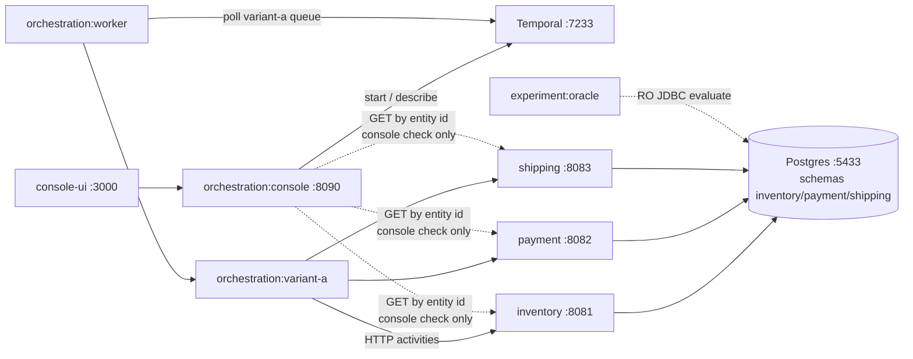
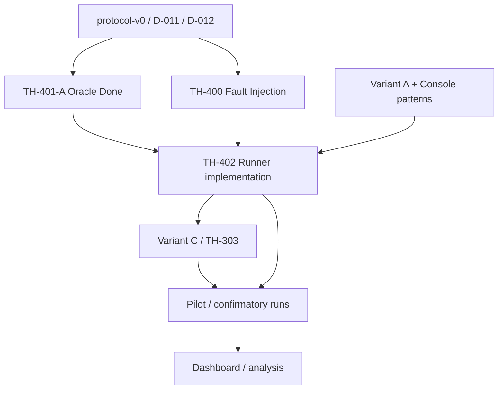

# Experiment Runner — contract & design analysis (TH-402 design)

| Field | Value |
| --- | --- |
| **Status** | **Design contract APPROVED** (Owner, 2026-11-02) · **implementation NOT authorized** · not implemented |
| **Revision** | **3.1** + Owner approval record (R1 / R6 / R14) |
| **Decision** | **D-402** in `coordination/DECISION_LOG.md` |
| **Ticket** | TH-402 · Taiga **#37** (design approved / impl not started; preserve SP & deps) |
| **Branch inspected** | `main` @ `31256cdc288aa071fa9f873a454afc2a1d91c46a` |
| **Depends on (research)** | protocol-v0 / D-012 · TH-011 / D-011 · TH-401-A Option C · D-201 · D-202 · D-208 · D-016 |
| **Vault context** | Architecture Overview · Variant A As Built · Independent Oracle note · Engineering Lessons · Experimental Protocol · Research Questions · Knowledge Systems |
| **Non-goals (this approval)** | No Runner/FaultController/CLI code · no Gradle · no migrations · no TH-400/C · no Oracle/protocol semantic rewrite beyond recording R14 sequence |
| **Label legend** | **Source fact** · **Approved decision** · **Recommendation** · **Open question (Owner)** · **Assumption** · **Limitation** |

> The Runner is the **experimental harness** that executes controlled trials for Variant A vs Variant C under identical business inputs, fault profiles, observation windows, and Independent Oracle evaluation. Temporal status and LLM text never define RQ1/RQ2 outcomes.  
> **Owner approval of this design does not authorize implementation.** A separate `NEXT_TASK=approved` is required before coding.

---

## 1. Current architecture and relevant components

### 1.1 What exists today (**Source fact**)



| Component | Module / path | Role vs Runner |
| --- | --- | --- |
| Variant A workflow | `:orchestration:variant-a` | Production-path saga; `OrderFulfillmentWorkflow.fulfill(OrderFulfillmentInput)` on queue `variant-a-order-fulfillment` |
| Worker | `:orchestration:worker` | Polls Temporal; required for real runs |
| Experiment Console | `:orchestration:console` + `console-ui/` | **Manual** happy-path starter; **not** the experiment harness |
| Independent Oracle | `:experiment:oracle` | Authoritative RQ1/RQ2 classification (TH-401-A Option C) |
| Contracts | `:contracts` | Shared DTOs; oracle labels in `contracts.oracle.BusinessOutcome` |
| Fault placeholders | `experiment/faults/.gitkeep`, `experiment/runner/.gitkeep` | Empty stubs; **not** in `settings.gradle.kts` |
| Results layout (planned) | protocol-v0 §10 `experiment/results/` | Directory convention; not implemented |

Gradle includes (**Source fact**): `contracts`, `services:*`, `orchestration:*`, `experiment:oracle`.  
**Does not include:** `experiment:runner`, `experiment:faults`.

### 1.2 Console vs Runner (**Source fact** + **Recommendation**)

| | Console (TH-205) | Runner (TH-402) |
| --- | --- | --- |
| Purpose | Manual exploration / demos | Controlled, repeatable experiments |
| Start API | `POST /api/console/runs` | Dedicated runner API / CLI (future) |
| Faults | None in BFF start path | Mandatory F0–F3 profiles |
| Timing | Human waits | `T_observe=30s`, `T_run_max=120s` (**Approved:** D-012) |
| Classification | `BusinessConsistencyCheck` (workflow-result IDs) | `IndependentOracle.evaluate` by `orderId`+`sku` |
| Persistence | None | Manifest + trial results + export |

**Recommendation:** Do **not** extend the console into the confirmatory harness. Reuse Temporal client patterns and reset SQL from console/Variant A ITs; keep Runner as a separate process/module so exploratory UI cannot contaminate experiment semantics.

### 1.3 Two distinct `BusinessOutcome` types (**Source fact**)

| Enum | Package | Values |
| --- | --- | --- |
| Workflow outcome | `orchestration.varianta.model.BusinessOutcome` | `SUCCESS`, `COMPENSATED_FAILURE`, `AMBIGUOUS` |
| Oracle outcome | `contracts.oracle.BusinessOutcome` | `CONFIRMED_SUCCESS`, `CONFIRMED_FAILURE`, `AMBIGUOUS`, `INVALID` |

**Recommendation:** Trial result schema stores **both** (workflow outcome optional/diagnostic; oracle classification authoritative). Never map workflow `SUCCESS` → RQ1 success without Oracle.

### 1.4 Existing fault-related mechanisms (**Source fact**)

| Mechanism | Where | Covers |
| --- | --- | --- |
| `X-Thesis-Fault` + `thesis.payment.fault-injection-enabled` | Payment service (D-016) | F3 (`F3_CAPTURE_LOST_RESPONSE`), charge fail/unknown, resolve controls |
| `OrderFulfillmentInput.chargeFaultHint` / `resolveFaultHint` | Variant A workflow input | Passes payment fault header from orchestrator |
| `RecordingActivities.failArrangeWithBusiness` / `failConsumeWithBusiness` | Variant A **tests only** | Simulated F2 / consume-fail; **not** a shared service mechanism |
| Inventory / shipping fault headers | — | **Absent** |

**Implication:** TH-400 must still deliver a **variant-agnostic** arming mechanism for F1/F2 (and standardize F0/F3). Runner design assumes a `FaultController` interface; payment headers are an existing building block, not the full solution.

### 1.5 Reset pattern already used in ITs (**Source fact**)

Console E2E and Variant A compensation ITs reset per test:

```sql
-- inventory
DELETE FROM operation_log; DELETE FROM idempotency_records; DELETE FROM reservations;
UPDATE stock SET on_hand = 100, held = 0 WHERE sku = 'SKU-MVP-1';
-- payment / shipping
DELETE FROM operation_log; DELETE FROM idempotency_records; DELETE FROM payments/shipments;
```

Protocol-v0 §3 baseline: SKU `SKU-MVP-1`, `onHand=100`, `held=0`, fresh `orderId`, `qty=1`.

### 1.6 Oracle API surface (**Source fact**)

```text
IndependentOracle.evaluate(OracleEvaluationRequest(orderId, sku, workflowId?, trialId?))
  → OracleResult {
      classification ∈ {CONFIRMED_SUCCESS, CONFIRMED_FAILURE, AMBIGUOUS, INVALID},
      pattern ∈ {SUCCESS, F0, F1, F2, NONE},
      reasonCode, violatedInvariants, warnings, snapshot,
      workflowId, trialId, evaluatorVersion, evaluatedAt
    }
```

Classification uses only durable business rows. `workflowId`/`trialId` are metadata. Absolute `onHand` Δ vs pre-run baseline is **not** proven by the Oracle today (warning on SUCCESS) — harness should capture baseline if Owner wants that check later.

### 1.7 Approved protocol constants relevant to Runner (**Approved decision**)

| Constant | Value | Source |
| --- | --- | --- |
| `T_observe` | 30s after workflow stop | D-012 / protocol-v0 §2.3 |
| `T_run_max` | 120s wall clock from trial start | D-012 |
| Labels | Four oracle outcomes; timeout ≠ failure | D-011 / D-012 |
| Faults | F0–F3; F3 mandatory ambiguous payment | protocol-v0 §4 |
| MVP variants | A vs C | D-009 |
| Activity timeouts | Engineering defaults; **not** protocol constants | D-202-1 / D-202-4 |

### 1.8 Taiga #37 and Obsidian inputs (**Source fact** + **Conflict**)

**Taiga #37** (`[TH-402] Experiment runner + result schema`):

| Field | Value |
| --- | --- |
| Status | **New** (not Done; not In progress) |
| Points | **3** (convention 1 SP ≈ 1 focused day) |
| Epic | P5 — Experiment Infrastructure |
| Depends on (description) | **TH-400, TH-401, TH-303** |
| Acceptance (import) | `JSON/CSV: variant, fault, end-state, timings, tools` |

**Conflict (report — do not silently resolve):**

| Claim | Tension |
| --- | --- |
| Taiga depends on **TH-400** before Runner | Staging **Recommendation** (§11): skeleton F0+A + Oracle can land *before* full TH-400 if Owner allows (RQ-R9) |
| Taiga depends on **TH-303** (Variant C fairness logging) | Full A×C confirmatory needs C; **Runner design + A/F0 harness** does not need TH-303. Treat TH-303 as dependency for *complete* acceptance of #37 as originally imported, not for design freeze |
| Acceptance mentions **tools** | Tool-call metrics are RQ3 / Variant C — Runner schema should reserve fields; **not** required for A-only pilot |

**Obsidian influence (not duplicated here):** vault notes establish that console ≠ oracle, incomplete compensation ≠ CONFIRMED_FAILURE, and knowledge SoT split (GitHub / Obsidian / Taiga). This design stays in GitHub as technical contract; vault holds research framing.

---

## 2. Proposed Runner responsibilities and boundaries

### 2.1 Responsibilities (**Recommendation**)

1. Load an **ExperimentDefinition** (protocol id, phase, cell matrix, n, git SHA capture).
2. For each **Trial**: reset/baseline → arm fault → start variant → detect terminal → observe → evaluate Oracle → disarm → persist → export-ready artifact.
3. Enforce isolation between trials and fair A/C pairing.
4. Separate **technical/harness failures** from **business oracle labels** (protocol-v0 §1.1 / §8.1).
5. Produce JSON (+ CSV export) suitable for later analysis/dashboard (TH-403/TH-601), without implementing the dashboard.

### 2.2 Explicit non-responsibilities (**Recommendation**)

| Out of Runner scope | Owner |
| --- | --- |
| Oracle classification semantics | `:experiment:oracle` (frozen) |
| Fault *implementation* inside services / Toxiproxy | TH-400 |
| Variant C LLM policy / prompts | TH-300+ |
| Statistical analysis / confirmatory freeze | TH-501 / TH-601 |
| Grafana / dashboard UI | Final phase |
| Changing protocol-v0 constants | Owner + Decision Log |
| Manual console UX | TH-205 (keep separate) |

### 2.3 Suggested module placement (**Recommendation**)

| Artifact | Placement |
| --- | --- |
| Core library | Future Gradle module `:experiment:runner` (directory already reserved) |
| Process entry | Thin CLI **or** Spring Boot app under same module — **Open question** |
| Fault adapter SPI | Interface in runner; implementations in `:experiment:faults` or services (TH-400) |
| Oracle dependency | Compile dependency on `:experiment:oracle` only (no Temporal in oracle) |
| Variant adapters | Small adapters calling Temporal for A (and later C); no business logic duplication |

### 2.4 Responsibility split (**Recommendation**)

| Concern | Owner component |
| --- | --- |
| Business mutations / entity truth | inventory / payment / shipping |
| Workflow orchestration & retries | Temporal + Variant A/C workers |
| Fault *mechanism* | TH-400 (+ existing payment header as building block) |
| Fault *schedule* (when arm/disarm) | **Runner** |
| Classification labels | **Independent Oracle** only |
| Reset / baseline / trial matrix / timings / persistence / export | **Runner** |
| Manual exploration | Console (out of confirmatory path) |

---

## 3. Experiment and trial lifecycle

### 3.1 Definitions (**Recommendation**)

| Concept | Meaning |
| --- | --- |
| **Experiment** | Planned study unit: protocol id, phase (`pilot` \| `confirmatory`), variant set, fault set, repetitions `n`, code/config manifest, optional pairing strategy |
| **Trial** | One atomic execution: one variant × one fault profile × one repetition index, one fresh `orderId`, one Oracle evaluation at TERMINAL |
| **Cell** | Aggregation key `(variant, faultProfile)` across `n` trials |

An experiment **contains** many trials. RQ rates are computed over trials (with exclusions), not over the experiment object itself.

### 3.2 Lifecycle (normative for harness)

```mermaid
sequenceDiagram
  participant Exp as ExperimentController
  participant R as TrialRunner
  participant Reset as StateReset
  participant F as FaultController
  participant V as VariantAdapter
  participant T as Temporal
  participant O as IndependentOracle
  participant Store as ResultStore

  Exp->>R: next TrialSpec
  R->>Reset: reset + verify baseline (I1 seed)
  Reset-->>R: BaselineSnapshot
  R->>Store: write manifest (git SHA, protocol, config)
  R->>F: arm(faultProfile, trialId)
  F-->>R: ArmedFaultRecord
  R->>V: start(trial inputs)
  V->>T: WorkflowClient.start
  T-->>V: workflowId, runId
  loop until confirmed Temporal terminal OR T_run_max
    R->>T: describe / poll
  end
  alt confirmed stop before T_run_max
    R->>R: terminatedBy=WORKFLOW_STOP; wait full T_observe 30s
  else T_run_max while still RUNNING
    R->>T: Temporal terminate (R6; not cancel; not compensation)
    R->>R: establish Temporal quiescence
    alt not quiesced
      R->>Store: EXCLUDED WORKFLOW_NOT_QUIESCED; block next trial
    else quiesced
      R->>R: wait full T_observe 30s (R14)
    end
  end
  opt workflowQuiesced
    R->>O: evaluate once
    O-->>R: OracleResult
  end
  R->>F: disarm(trialId)
  F-->>R: DisarmAck
  R->>Store: atomic persist TrialRecord (§5.5)
  R-->>Exp: TrialCompleted
```

### 3.3 Phase detail

| Phase | Runner action | Notes |
| --- | --- | --- |
| **Define** | Validate ExperimentDefinition against protocol id | Reject unknown fault ids / variants |
| **Create trial** | Allocate `trialId`, `orderId` (UUID), `workflowId` convention | Console uses `order-{orderId}` — keep compatible |
| **Prepare** | Truncate/reset business tables; set stock baseline; verify | Capture baseline for optional onHand Δ |
| **Select variant / fault** | From trial matrix | Same for A and C in a pair |
| **Arm fault** | `FaultController.arm` **before** start | Fail → technical exclusion, not oracle label |
| **Execute** | Start workflow; record `t0` | Do not treat Temporal COMPLETED as success |
| **Terminal detect** | See §3.5 — distinguish confirmed workflow stop vs `T_run_max` | Values unchanged: `T_observe=30s`, `T_run_max=120s` (**Approved** D-012) |
| **Quiesce** | Ensure workflow cannot keep mutating before Oracle | §3.5 |
| **Observe** | See §3.5.1 — full `T_observe` after normal stop **and** after forced terminate+quiesce (**R14**) | Constants unchanged (30s) |
| **Oracle** | Exactly once at harness TERMINAL when quiesced | Independent of workflow/LLM |
| **Persist** | Durable write (§5.5); never silent overwrite | §9 |
| **Complete / error** | Disarm in `finally`; mark dual statuses | §9 · §9.1 |

### 3.4 Distinguishing experiment completion

An experiment is complete when every planned trial has a durable terminal `harnessStatus` ∈ {`COMPLETED`, `EXCLUDED`} or the run ends in `ABORTED_EXPERIMENT`. Pilot vs confirmatory is a **field on the experiment**, not a different runtime (protocol-v0 §7).

### 3.5 `T_run_max` vs confirmed workflow termination

**Approved (unchanged constants):** `T_observe = 30s`, `T_run_max = 120s` from trial start (protocol-v0 §2.3 / D-012). D-202-4: Variant A has **no** workflow execution timeout inside Temporal; the harness owns the wall-clock cap.

| Concept | Meaning |
| --- | --- |
| **Confirmed workflow termination** | Temporal execution status ∈ {COMPLETED, FAILED, CANCELED, TERMINATED, TIMED_OUT} **observed** by the Runner — workflow is no longer RUNNING |
| **`T_run_max` reached** | Wall clock ≥ `t0 + 120s` while the workflow may still be RUNNING — harness deadline only; **not** proof Temporal has stopped |

#### 3.5.1 When `T_observe` applies (**Approved decision** — D-402 / R14)

Protocol-v0 §2.3 (**Approved** values). Owner **R14** (2026-11-02) resolves the underspecified forced-termination observe path for this design contract:

| Path | Runner behavior |
| --- | --- |
| **Normal stop** (Temporal terminal **before** `T_run_max`, without harness terminate) | `terminatedBy=WORKFLOW_STOP` → full `T_observe` (30s) → Oracle once |
| **Forced path** (`T_run_max` while still RUNNING) | Exact sequence (**Approved** R14): |

```text
T_run_max reached
  → Temporal workflow terminate (§3.5.2)
  → establish required Temporal quiescence (§3.5.3)
  → if quiescence OK: wait full T_observe = 30s
  → evaluate Independent Oracle once
```

If required quiescence **cannot** be established → `harnessStatus=EXCLUDED`, `exclusionReason=WORKFLOW_NOT_QUIESCED`; **do not** treat as a business outcome; **block** the next trial. No Oracle for RQ inclusion.

This records how the harness applies the approved `T_observe` constant after forced stop; it does **not** rewrite other protocol-v0 semantics.

#### 3.5.2 Temporal terminate on `T_run_max` (**Approved decision** — D-402 / R6)

| Rule | Statement |
| --- | --- |
| Action | Use Temporal **workflow terminate** when `T_run_max` fires while RUNNING. **Do not** use cancellation as a substitute. |
| Harness control only | Termination is a **harness-control** action. It is **not** business compensation and **does not** establish a business outcome. |
| Runner must not compensate | The Runner **must not** invoke cancel/refund/release/arrange (or other compensate) APIs itself because of terminate. |
| Actual state | Committed service side effects remain. Already-dispatched HTTP may still complete (**Limitation** — §3.5.3). |
| Oracle | Classifies **only** durable business state after the R14 sequence. Terminate alone **never** auto-assigns `CONFIRMED_FAILURE` (**Approved** timeout≠failure / D-011). |

#### 3.5.3 Quiescence: Temporal vs service-side effects (**Approved clarification** under D-402)

**Temporal quiescence** = Runner has observed a terminal Temporal execution status (after normal stop or after terminate + quiesce wait).

| Claim | Allowed? |
| --- | --- |
| `workflowQuiesced=true` means Temporal execution is no longer RUNNING | **Yes** (by definition) |
| `workflowQuiesced=true` proves all already-dispatched HTTP requests have finished or that service-side effects have drained | **No** |

**Limitation (explicit):** Temporal terminate does **not** guarantee drainage of in-flight worker HTTP or delayed service commits. No distributed drain protocol is introduced in this design.

**Safety rule (unchanged intent):** If the Runner cannot establish **trustworthy** Temporal quiescence for the trial (still RUNNING after quiesce wait, describe failure, or otherwise insufficient trust to take an RQ snapshot) → `EXCLUDED` / `WORKFLOW_NOT_QUIESCED`; block next trial; do not invent a business label.

**Quiesce wait:** configurable pilot default **5s** — not a protocol constant (RQ-R13 still open for tuning, not for the terminate/observe sequence).

---

## 4. Proposed interfaces and contracts

### 4.1 Trial execution contract — minimal fields

Do **not** treat every interesting diagnostic as required for classification. Minimal **required** fields vs **recommended** diagnostics:

Layer the trial record into five buckets (do **not** flatten into one undifferentiated blob):

| Bucket | Role |
| --- | --- |
| **Configuration** | Planned inputs: variant, faultProfileId, business inputs, protocolId, phase, repetitionIndex |
| **Execution metadata** | Timings, Temporal ids, terminatedBy, harnessStatus, gitSha, configVersion |
| **Oracle result** | classification, pattern, reasonCode, evaluatorVersion, evaluatedAt |
| **Diagnostic evidence** | snapshot, warnings, invariants, workflowOutcome, faultArmedRecord, traces |
| **Infrastructure failure** | exclusionReason, error class/message — never used as oracle label |

#### Required — configuration

| Field | Why required |
| --- | --- |
| `experimentId` | Groups trials; links to manifest |
| `trialId` | Stable primary key for artifacts / exclusions / resume |
| `protocolId` | Must be `protocol-v0` (or later frozen id) for confirmatory |
| `phase` | `pilot` \| `confirmatory` |
| `variant` | `A` \| `C` |
| `faultProfileId` | `F0`…`F3` (protocol ids) |
| `repetitionIndex` | 0…n-1 within cell |
| `orderId` | Oracle + saga correlation |
| `sku`, `qty`, `amountMinor`, `currency` | Business inputs (identical A/C) |
| `configVersion` | Hash/version of ExperimentDefinition for audit |

#### Required — execution metadata

| Field | Why required |
| --- | --- |
| `gitSha` | Reproducibility (overlaps TH-403; capture early) |
| `t0`, `tWorkflowStop?`, `tTerminal`, `tOracle` | Lifecycle clocks |
| `faultTriggeredAt` | When FaultController successfully armed for this trial (§10.5) |
| `faultObservedAt?` | Optional visibility clock; **must be null for F0**; else only if reliably observed (§10.5) |
| `terminatedBy` | `WORKFLOW_STOP` \| `T_RUN_MAX` \| `HARNESS_ABORT` |
| `workflowQuiesced` | `true` iff Temporal terminal status confirmed before any RQ Oracle |
| `workflowId`, `runId?` | Temporal correlation (diagnostic + restart) |
| `harnessStatus` | `COMPLETED` \| `EXCLUDED` \| `ABORTED_EXPERIMENT` only — §9.1 |

#### Required — Oracle result

| Field | Why required |
| --- | --- |
| `oracle.classification` | Sole RQ1/RQ2 business label |
| `oracle.pattern` | F0–F2 / SUCCESS / NONE |
| `oracle.reasonCode` | e.g. `COMPENSATION_INCOMPLETE`, `UNKNOWN_PAYMENT` |
| `oracle.evaluatorVersion` | e.g. `th-401-a-1` |
| `exclusionReason?` | Protocol §8.1; null if included in RQ rates |

#### Recommended — diagnostics & infra errors

| Field | Role |
| --- | --- |
| `workflowOutcome` | Variant A/C structured result (**separate** enum space) |
| `faultArmedRecord` + `faultVerifyResult` | Intended vs actual injector config |
| `baselineStock` / `terminalStock` | Future absolute onHand Δ |
| `oracle.snapshot` / `warnings` / `violatedInvariants` | Evidence |
| `temporalStatus` | RUNNING/COMPLETED/FAILED/… |
| `modelId` / `temperature` / `toolCallStats` | Variant C / RQ3 (Taiga “tools” acceptance) |
| `traceRef` | Pointer to history export |
| `infraError` | Structured technical error if excluded |

**Recommendation:** Persist workflow outcome and Temporal status for mismatch analysis (TH-208 / independence), but **never** let them override Oracle.

### 4.2 Core Java-shaped contracts (**Recommendation** — design only)

```text
ExperimentDefinition {
  experimentId, protocolId, phase,
  variants[], faultProfileIds[], n,
  businessDefaults { sku, qty, amountMinor, currency },
  timing { tObserve, tRunMax },  // default from protocol-v0
  pairing { strategy },          // e.g. PAIR_A_C_PER_FAULT
  gitSha, createdAt
}

TrialSpec {
  experimentId, trialId, variant, faultProfileId, repetitionIndex,
  orderId, businessInputs, workflowId
}

FaultController {
  arm(FaultArmRequest) -> ArmedFaultRecord
  verify(ArmedFaultRecord, TrialSpec) -> FaultVerifyResult  // pre-start or post-arm check
  disarm(trialId) -> void
  describe(faultProfileId) -> FaultProfileDescriptor
}

VariantAdapter {
  start(TrialSpec, ArmedFaultRecord?) -> ExecutionHandle  // workflowId, runId
  awaitStop(handle, deadline) -> WorkflowStopInfo
  terminate(handle, reason) -> void                       // T_run_max: Temporal terminate (not cancel)
  readWorkflowOutcome(handle) -> Optional<WorkflowOutcomeView>
}

TrialRunner {
  run(TrialSpec) -> TrialRecord
}

ResultStore {
  saveExperiment(ExperimentDefinition)
  saveTrial(TrialRecord)
  exportJson(experimentId) / exportCsv(experimentId)
}

StateReset {
  resetToProtocolBaseline(sku) -> BaselineSnapshot
  verifyBaseline(BaselineSnapshot) -> void  // fail → EXCLUDED / do not start
}
```

### 4.3 VariantAdapter notes (**Recommendation**)

- **Variant A:** Temporal client start of `OrderFulfillmentWorkflow` (same as console), task queue `variant-a-order-fulfillment`, workflow id `order-{orderId}`.
- **Variant C:** Same business inputs and fault arming; different task queue / workflow type when implemented. Adapter interface keeps Runner variant-agnostic.
- Prefer **service-side** fault arming (TH-400) so A and C do not need divergent “fault hint” fields. Until then, A may pass `chargeFaultHint` for payment-only experiments — document as interim.

---

## 5. Proposed persistence model

### 5.1 What to store (**Recommendation**)

| Entity | Contents |
| --- | --- |
| `experiments` | Definition + manifest (protocol, phase, git SHA, n, matrix, timing) |
| `trials` | One row/document per trial: inputs, timings, harnessStatus, exclusion, Temporal ids, workflow outcome |
| `trial_oracle_results` | Classification, pattern, reason, invariants, evaluatorVersion, evaluatedAt |
| `trial_evidence` | Snapshot JSON, warnings, fault armed record, optional traces (large) |

### 5.2 PostgreSQL vs files

| Option | Pros | Cons |
| --- | --- | --- |
| **A. File-first** under `experiment/results/` (protocol-v0 §10) | Matches protocol layout; easy gitignore of raw; simple MVP | Weaker query; concurrent writers need discipline |
| **B. Postgres schema `experiment`** | Durable, queryable, aligns with existing Postgres | Needs migrations (future task); ops complexity |
| **C. Dual** — Postgres SoT + JSON/CSV export | Best for dashboard + thesis archive | More implementation |

**Recommendation (MVP):** **A then C** — implement file-first JSON per trial + experiment manifest (protocol-aligned), with a stable schema version field; add Postgres `experiment` schema when dashboard/analysis needs it (not blocking first runner ITs).  
**Topology note (**Source fact**):** business data lives in schemas `inventory`/`payment`/`shipping` on DB `business`; Temporal has its own store. Runner results must **not** write into service schemas. Dedicated `experiment` schema (later) or filesystem under `experiment/results/` only.  
**Open question (Owner):** Confirm file-first MVP vs Postgres-from-day-one.

### 5.3 Export (**Recommendation**)

- **JSON:** one file per trial + `experiment.json` index (full fidelity, including evidence). Matches Taiga #37 acceptance (variant, fault, end-state, timings; tools when C).
- **CSV:** flat columns for analysis: `experimentId,trialId,variant,fault,repetition,oracle_classification,oracle_pattern,reason,terminatedBy,t_terminal_ms,exclusionReason,gitSha,…`
- Excluded trials remain in archive with `exclusionReason` (protocol §8.1).

### 5.4 No migrations in this design task

Schema DDL is deferred to implementation approval. This document only freezes the **logical** model.

### 5.5 Durable file writes and resume (**Recommendation**)

Layout (protocol-aligned): `experiment/results/{phase}/{experimentId}/trials/{trialId}.json` (+ `experiment.json` index).

#### Safe write strategy

1. Write to a sibling temp file: `{trialId}.json.partial` (or `.tmp` in the same directory).  
2. `fsync` (or equivalent) the temp file.  
3. Atomic rename to `{trialId}.json` (POSIX rename over same filesystem).  
4. Update `experiment.json` / index via the same temp+rename pattern.  
5. Never truncate-in-place the canonical `{trialId}.json`.

#### Persistence failure after successful Oracle evaluation (**Approved clarification** — D-402)

If Independent Oracle evaluation **succeeds** but durable persistence fails:

1. Keep the evaluated `OracleResult` (+ trial metadata) **in memory**.  
2. **Retry** atomic persistence (§ write strategy).  
3. **Do not** re-run the business trial / workflow.  
4. **Do not** allocate a new execution under the **same** `trialId`.  
5. **Do not** overwrite an existing durable trial artifact with a different execution’s result.  
6. If durable write still cannot be recovered → record a **technical harness** failure (`EXCLUDED` / `PERSISTENCE_FAILURE` or incomplete `.partial`); **do not fabricate** a `COMPLETED` record.

#### Partial / corrupt artifacts

| Situation | Handling |
| --- | --- |
| Only `*.partial` exists | Incomplete — not COMPLETED; re-run of cell (if any) needs **new** `trialId` + `orderId` |
| Canonical JSON fails schema/parse | Move to `corrupt/`; never silently overwrite |
| Canonical JSON with terminal `harnessStatus` | **Immutable** — refuse overwrite by a new execution |

#### Resume after Runner restart

1. Load experiment index + scan trial files.  
2. Skip any `trialId` with durable `COMPLETED` / `EXCLUDED` — **never re-execute**, never silent overwrite.  
3. Incomplete / partial → list in archive; any later cell attempt uses **new** `trialId` + **new** `orderId`.  
4. Best-effort disarm / quiesce audit before continuing.  
5. Do not resume a Temporal workflow mid-flight as the same trial.

**Open question (RQ-R10):** auto-continue matrix vs operator ack after incomplete cells.

---

## 6. Oracle integration

### 6.1 Rules preserved (**Approved decision** — do not change)

| Rule | Behavior |
| --- | --- |
| Labels | `CONFIRMED_SUCCESS` \| `CONFIRMED_FAILURE` \| `AMBIGUOUS` \| `INVALID` |
| Incomplete compensation | `AMBIGUOUS`, `pattern=NONE`, reason `COMPENSATION_INCOMPLETE` (+ evidence) |
| Invariant break | `INVALID` |
| Clean F0–F2 only | `CONFIRMED_FAILURE` |
| `ARRANGED+CAPTURED+HELD` at TERMINAL | `AMBIGUOUS` if I1–I4 pass (partial / incomplete package) |
| Authority | Entity state; operation logs diagnostic |
| Independence | No Temporal / LLM inputs to classifier |

### 6.2 Runner obligations (**Recommendation**)

1. Call Oracle **exactly once** at TERMINAL (after observe or forced deadline) for the authoritative label.
2. Pass `orderId` + protocol `sku`; attach `workflowId`/`trialId` as metadata only (Oracle API already ignores them for classification — **Source fact**).
3. Persist full `OracleResult` (incl. snapshot) as evidence.
4. If Oracle throws / DB unreachable → `harnessStatus=EXCLUDED`, `exclusionReason=ORACLE_FAILURE` (category TECHNICAL) — **do not** invent a classification.
5. Optional future TH-401-B API cross-check: disagreement → `ORACLE_DISAGREEMENT` exclusion (protocol), not silent relabel.
6. Capture `baselineStock` before start so a future harness check can verify absolute onHand Δ without changing Oracle semantics.

### 6.3 Snapshot consistency & re-evaluation (**Recommendation**)

| Topic | Guidance |
| --- | --- |
| Timing | Evaluate only at harness TERMINAL (after `T_observe` or `T_run_max`) — matches protocol / I4 note |
| Consistency | Oracle uses REPEATABLE READ RO snapshot load (**Source fact**); Runner must not mutate business DB between observe end and evaluate |
| Re-evaluation | Allowed only as **forensic** re-run producing a *new* evidence artifact with new `evaluatedAt`; never silently overwrite the original confirmatory label without an exclusion flag |
| Idempotency | `trialId` + `oraclePass=0` is the canonical RQ label; additional passes are `oraclePass≥1` diagnostics |

### 6.4 What Runner must not do

- Use console `BusinessConsistencyCheck` for RQ labels.
- Map `T_run_max` or activity timeout → `CONFIRMED_FAILURE`.
- Infer label from Temporal status or workflow `BusinessOutcome`.
- Skip Oracle when workflow reports `SUCCESS`.
- Treat missing workflow entity IDs as proof of absent side effects (Oracle reads by `orderId`; TH-208 lesson).

---

## 7. Fault injection integration

### 7.1 Required interface (**Recommendation**)

```text
FaultArmRequest {
  trialId, faultProfileId ∈ {F0,F1,F2,F3},
  orderId,           // scope injection to this trial when possible
  variant,           // for audit only — must not change injector behavior
  correlationKeys    // idempotency / header scopes
}

ArmedFaultRecord {
  faultProfileId,
  mechanism,         // e.g. SERVICE_HEADER | TOXIPROXY | TEST_DOUBLE (pilot-only)
  effectiveConfig,   // exact headers/rules/flags actually applied
  armedAt
}
```

**Invariant:** For a given `faultProfileId`, A and C receive the **same** `effectiveConfig` (protocol fairness).

### 7.2 When to arm / disarm (**Recommendation**)

| Moment | Action |
| --- | --- |
| After baseline verified, **before** `VariantAdapter.start` | `arm` |
| In `finally` after Oracle (or after technical fail) | `disarm` |
| Experiment abort / Runner restart | Best-effort disarm all armed trials; refuse new trials if global fault flag still set |

F0: `arm` is a no-op that still returns an `ArmedFaultRecord` (`mechanism=NONE`) for audit symmetry.

### 7.3 Isolation and leak prevention (**Recommendation**)

1. Prefer **per-orderId / per-idempotency-key** injection (payment header already request-scoped) over process-global toggles.
2. If a global flag must be used (`fault-injection-enabled`), keep it enabled for the whole experiment session but ensure **profile rules** are trial-scoped.
3. After each trial: disarm + DB reset (clears leftover entities); verify no armed profile remains.
4. Detect cross-talk: if Oracle/DB shows unexpected fault side effects on a fresh orderId before start → `EXCLUDED` / `FAULT_CROSSTALK`.
5. Never leave F3/F1/F2 armed across experiment boundaries.

### 7.4 Mapping protocol faults → current reality (**Source fact** + **Recommendation**)

| Profile | Protocol intent | Current repo capability | TH-400 need |
| --- | --- | --- | --- |
| **F0** | No injection | Available | Record NONE |
| **F1** | Fail after reserve / before successful pay path | Partial: `CHARGE_FAIL` via payment header approximates “fail at pay”; inventory-side fail **missing** | Define canonical F1 (payment fail after hold vs reserve fail) |
| **F2** | Arrange fails after CAPTURED | Only test doubles today | Service-side shipping fault or equivalent shared mechanism |
| **F3** | Ambiguous payment | `F3_CAPTURE_LOST_RESPONSE` (D-016) | Standardize arming without relying on Variant-A-only input fields |

**Recommendation for TH-400 (not implementing here):** one mechanism family for all services (header-based deterministic faults gated by config), usable by A and C identically; Toxiproxy only if Owner chooses network-level faults (protocol allows either).

### 7.5 Recording and verifying actual fault configuration

1. Persist `ArmedFaultRecord.effectiveConfig` on every trial (including F0).  
2. Call `FaultController.verify` after arm (and optionally sample mid-trial for global injectors): confirm intended profile is active and no leftover profile from a prior trial.  
3. Failed arm / failed verify → **do not start** (or abort) the trial; exclusion `FAULT_ARM_FAILED` / `WRONG_FAULT` / `FAULT_VERIFY_FAILED` — **not** a valid observation under the intended fault cell.  
4. Failed disarm → block subsequent trials until cleared (`FAULT_DISARM_FAILED`).

---

## 8. Isolation and reset strategy

### 8.1 Dedicated experimental environment (**Recommendation**)

Destructive reset is **only** allowed against an explicitly designated experimental database/environment.

| Requirement | Rule |
| --- | --- |
| Dedicated target | Runner config MUST name an experimental JDBC URL / Compose profile / env id (e.g. `THESIS_EXPERIMENT_ENV=local-lab`) distinct from any non-lab credential set |
| Allowlist gate | Before any DELETE/TRUNCATE/UPDATE stock reset, verify connection metadata against an allowlist (host, port, database name, optional `application_name`) |
| Fail closed | Mismatch → `harnessStatus=EXCLUDED` / experiment abort with `WRONG_DATABASE`; **zero** destructive SQL |
| Separation | Do not reset Temporal’s persistence DB; do not target production-like unnamed defaults without the gate |

**Source fact today:** local Compose Postgres `localhost:5433` / DB `business` is the lab stack. The design requires making “this is the experiment DB” an **explicit** harness precondition, not an implicit habit.

**Open question (RQ-R12):** whether confirmatory runs require a second Compose project / DB name (e.g. `business_exp`) separate from developer ad-hoc testing.

### 8.2 Concurrent execution lock (**Recommendation**)

While reset or a trial is in progress:

1. Acquire an exclusive **experiment lock** (file lock under `experiment/results/.locks/{envId}` and/or advisory lock on the experiment DB).  
2. Refuse a second Runner (or parallel Gradle IT that shares the same env) with `ENV_BUSY`.  
3. Console manual runs against the same env during confirmatory campaigns are **out of band** — document as operator rule; optional preflight that no non-Runner clients hold open mutating connections (**Assumption** / ops).

Default: **serial** trials within one Runner; **one** Runner per experimental env.

### 8.3 Reset ownership and ordering (**Recommendation**)

**Owner of reset:** Runner `StateReset` only (not services, not Oracle, not console).

**Order per trial (before arm):**

1. Hold experiment lock.  
2. Pass allowlist / env gate (§8.1).  
3. Confirm no other trial RUNNING for this env; best-effort: no active Temporal workflow left from prior failed quiesce (else `WORKFLOW_NOT_QUIESCED` / block).  
4. DELETE business tables in dependency-safe order: `operation_log` → `idempotency_records` → entity tables (`reservations` / `payments` / `shipments`) within each schema; then `UPDATE stock` baseline.  
5. Verify baseline (SKU row, `on_hand=100`, `held=0`, no leftovers).  
6. Allocate new `orderId` / `workflowId`.  
7. Enter arm phase (lock held for whole experiment run — **Recommendation**).

SQL shape matches existing ITs (**Source fact**) but gated as above. Do **not** DELETE mid-trial after `t0`. No app message bus to drain today (**Source fact**).

### 8.4 Equivalent initial conditions A vs C

| Control | Mechanism |
| --- | --- |
| Same stock / empty entities | Shared gated `StateReset` |
| Same business inputs | Experiment defaults + identical TrialSpec fields except `variant` |
| Same fault effectiveConfig | Shared `FaultController` |
| Same timing constants | ExperimentDefinition timing from protocol |
| Same Oracle | Same `IndependentOracle` build / evaluatorVersion |
| Same code | Single `gitSha` per experiment (rebuild workers before confirmatory) |

### 8.5 Residual MVP risks (cannot fully eliminate)

| Risk | Why residual | Mitigation |
| --- | --- | --- |
| Temporal / JVM / DB wall-clock jitter | Single-machine lab | Fixed timeouts; report variance |
| LLM nondeterminism (C) | Inherent | Record model/seed; variance in analysis |
| Reset against wrong DB | Ops mistake | Allowlist gate (§8.1) |
| Concurrent IT vs Runner | Shared lab | Env lock (§8.2) |
| Worker crash mid-trial | Infra | `EXCLUDED` / `HARNESS_CRASH`; disarm; quiesce |
| Absolute onHand Δ not in Oracle | TH-401-A limit | Harness baseline fields |
| Global fault flag misconfig | Payment config | Preflight + verify |
| Cache / connection pools | Possible subtle bias | Serial trials; optional worker restart between experiments |

---

## 9. Failure and recovery behavior

### 9.1 Two independent status dimensions (**Recommendation** + **Approved protocol**)

| Dimension | Field | Who sets it | Meaning |
| --- | --- | --- | --- |
| **Harness** | `harnessStatus` (+ `exclusionReason` / category when excluded) | Runner | Validity of the observation / experiment progress |
| **Business / Oracle** | `oracle.classification` (+ pattern, reason) | Independent Oracle only | End-state label under frozen TH-011 / Option C |

Never collapse into one enum.

#### Unambiguous harness status model (**Recommendation**)

Exactly one of:

| `harnessStatus` | Meaning |
| --- | --- |
| `COMPLETED` | Quiesced (as required); observe policy applied; Oracle evaluated; durable artifact OK — **valid** observation of the planned cell |
| `EXCLUDED` | Trial archived but **not** a valid RQ observation (infra / fault / quiesce / persist / wrong env / …) |
| `ABORTED_EXPERIMENT` | Experiment stopped; this trial (and remaining matrix) not continued as planned |

**`TECHNICAL_FAILURE` is not a `harnessStatus`.** It is an **exclusion reason category** (or `exclusionCategory=TECHNICAL`) under `harnessStatus=EXCLUDED`, alongside categories such as `FAULT_MISCONFIG`, `OPERATOR`, etc. Concrete codes remain e.g. `ORACLE_FAILURE`, `WORKFLOW_NOT_QUIESCED`, `WRONG_DATABASE`.

#### Derived `includeInRqRates` (**Recommendation** — no contradictory combos)

| `harnessStatus` | `includeInRqRates` | Notes |
| --- | --- | --- |
| `COMPLETED` | **`true`** | Must have Oracle result; must **not** carry `exclusionReason` |
| `EXCLUDED` | **`false`** | Must carry `exclusionReason` (+ category); oracle fields optional/null |
| `ABORTED_EXPERIMENT` | **`false`** | Experiment-level abort |

Forbidden: `COMPLETED` + `exclusionReason`; `EXCLUDED` without reason; inventing a parallel status that fights `includeInRqRates`.

#### Oracle `INVALID` vs technical exclusion (**Approved** + clarification)

| | Oracle `INVALID` | Technical exclusion (`EXCLUDED` + category TECHNICAL) |
| --- | --- | --- |
| Definition | Business **invariant violation** on snapshot | Harness/oracle/fault/DB/env failure (protocol-v0 §1.1) |
| Who decides | Oracle | Runner |
| RQ1 | Counts in `RQ1_invalid` | **Out** of RQ denominators |
| RQ2 | Not safe recovery | Out of RQ2 rates |
| Export | `harnessStatus=COMPLETED`, `oracle=INVALID`, `includeInRqRates=true` | `harnessStatus=EXCLUDED`, `includeInRqRates=false` |

**Do not** map technical failures to `INVALID`.

#### Export and statistics (**Approved protocol reference**)

Per protocol-v0 §1.1 / §8 / §8.1: RQ rates use only included runs; exclusions retained with reason; business labels for included runs are the four oracle outcomes.

### 9.2 Failure mode table

| Failure mode | `harnessStatus` | Oracle? | `exclusionReason` (if EXCLUDED) |
| --- | --- | --- | --- |
| Normal stop + `T_observe` + Oracle OK | `COMPLETED` | Yes | — |
| `T_run_max` + terminate + quiesced + full `T_observe` (R14) + Oracle OK | `COMPLETED` | Yes | — |
| `T_run_max` / terminate but **not** quiesced | `EXCLUDED` | No | `WORKFLOW_NOT_QUIESCED` (+ block next) |
| Observe ends after normal stop | → Oracle | Yes | — |
| Service unavailable at start/reset | `EXCLUDED` | No | `SERVICE_UNAVAILABLE` |
| Wrong DB / env gate | `EXCLUDED` | No | `WRONG_DATABASE` |
| Env lock busy | `EXCLUDED` | No | `ENV_BUSY` |
| Oracle throws | `EXCLUDED` | N/A | `ORACLE_FAILURE` |
| Fault arm / verify fails | `EXCLUDED` | No | `FAULT_ARM_FAILED` / `FAULT_VERIFY_FAILED` |
| Fault disarm fails after COMPLETED | keep COMPLETED; block next | Already done | experiment health / may `ABORTED_EXPERIMENT` if unrecoverable |
| Trial crash mid-flight | `EXCLUDED` or incomplete partial | Only if already COMPLETED path | `HARNESS_CRASH` |
| Operator stops matrix | `ABORTED_EXPERIMENT` | — | — |
| Persist fails after Oracle success | Prefer COMPLETED after retry; else `EXCLUDED` | Computed | `PERSISTENCE_FAILURE` |
| Duplicate `trialId` start | refuse / `EXCLUDED` | — | `DUPLICATE_TRIAL_ATTEMPT` |

All `EXCLUDED` rows use exclusion **category** `TECHNICAL` (or FAULT_MISCONFIG where appropriate) — not a fourth status.

**Critical rule (**Approved** + **Recommendation**):**  
`T_run_max`, activity timeouts, and Temporal `FAILED`/`TIMED_OUT` **must not** auto-assign `CONFIRMED_FAILURE`. Only Independent Oracle assigns business labels; timeouts often yield `AMBIGUOUS` (e.g. UNKNOWN payment).

---

## 10. Comparability and reproducibility

### 10.1 Controls owned by the Runner

- Identical TrialSpec business inputs for paired A/C cells  
- Shared reset + baseline verification  
- Shared FaultController effective config  
- Shared `T_observe` / `T_run_max`  
- Shared Oracle invocation  
- Serial (default) scheduling; explicit pairing strategy  
- Manifest: git SHA, protocol id, evaluatorVersion, fault descriptors, model id (C)  
- Refusal to run confirmatory if manifest incomplete  

### 10.2 Controls owned by the experimental protocol / Owner decisions

- Which faults exist (F0–F3) and definitions  
- Timing constant values  
- Success/failure/ambiguous/invalid semantics  
- Pilot vs confirmatory rules; confirmatory *n* (OWN-1)  
- Fairness constraints (no post-hoc scenario tuning)  
- Exclusion taxonomy  

### 10.3 Pairing and ordering (**Recommendation**)

| Strategy | Description |
| --- | --- |
| **PAIR_A_C_PER_REPETITION** (preferred) | For each fault × rep: run A then C (or randomized order with seed) under one reset each |
| **BLOCK_BY_VARIANT** | All A then all C — simpler ops, higher risk of temporal drift |

Record `scheduleSeed` and actual execution order. Avoid interleaving different fault profiles without disarm/reset.

### 10.4 Cache / state bias avoidance

- New `orderId` every trial  
- Full idempotency table clear  
- Disarm faults every trial  
- Do not reuse Temporal workflow ids  
- Variant C: clear any agent session memory between trials (when C exists)

### 10.5 Measurement boundaries, fault clocks & config versioning (**Recommendation**)

Protocol-v0 RQ2 metric text: `RQ2_recovery_duration` = **fault visibility → harness TERMINAL** (protocol §1). Timing **constants** `T_observe` / `T_run_max` stay frozen; this section only defines how the Runner **records** clocks so analysis can implement that definition.

#### Fault activation vs fault visibility

| Timestamp | When set | Meaning |
| --- | --- | --- |
| `faultTriggeredAt` | Immediately after successful `FaultController.arm` (+ verify) | **Activation** — always set (F0: arm completes with `mechanism=NONE`) |
| `faultObservedAt` | Optional; when orchestration first observes the injected failure | **Visibility** — see rules below |
| `t0` | Immediately before `VariantAdapter.start` | Trial execution start |
| `tWorkflowStop` | Confirmed Temporal terminal status | ≠ `T_run_max` fire alone |
| `tTerminal` | After full `T_observe` (normal path, or forced path after terminate+quiesce per R14) | Oracle immediately after when included |
| `tOracle` | Oracle `evaluatedAt` | Evidence clock |

**Activation ≠ visibility.** Rules for `faultObservedAt` (**Recommendation**):

1. **F0:** must remain **`null`** (`faultVisibilitySource=NOT_APPLICABLE`).  
2. Prefer **structured** events from VariantAdapter / activity results / typed workflow side-channel — **not** parsing free-text Temporal history messages or logs.  
3. If no reliable structured visibility signal → keep **`null`** + `faultVisibilitySource=UNAVAILABLE`; **never fabricate**.  
4. Improving structured emission is a Variant/TH-400 concern, not log scraping.

#### Appropriate RQ2 duration boundary (**Recommendation** interpreting protocol)

| Preferred numerator start | `faultObservedAt` when present — matches protocol “fault visibility” |
| --- | --- |
| Fallback (document as limitation) | If visibility unavailable: report duration from `faultTriggeredAt` **separately labeled** as activation-based, **not** claimed as protocol-canonical visibility duration |
| End | `tTerminal` (harness TERMINAL) |
| Exclude from RQ2 duration | Trials with `includeInRqRates=false`; trials without quiesce |

Do **not** change protocol formulas here; Runner supplies auditable clocks.

#### Other boundaries

| Boundary | Definition |
| --- | --- |
| Oracle span | `[tTerminal, tOracle]` — diagnostic; not RQ2 recovery unless protocol amended |
| Config versioning | `protocolId` + `configVersion` + `gitSha` + `oracle.evaluatorVersion` + fault descriptor digests |

**Do not invent confirmatory *n* or statistical thresholds** — OWN-1 / TH-501.

---

## 11. Dependencies and recommended implementation sequence

### 11.1 Proposed high-level order (**Recommendation** — not approved plan)

1. **TH-402 design** (this document)  
2. **TH-400** Fault Injection  
3. **TH-402 implementation** (runner + result schema + Oracle/fault integration)  
4. **Variant C** (TH-300…; TH-303 for tool logging)  
5. Experiment execution / analysis  
6. **Dashboard** (final)

This sequence is **technically sound** for minimizing F1/F2 API rework. It is **not** an Owner-approved implementation schedule and does **not** change Taiga dependencies.

### 11.2 Staged Runner vs Taiga #37 dependencies

| Runner capability | Needs TH-400? | Needs Variant C / TH-303? | Notes |
| --- | --- | --- | --- |
| Experiment/trial model + ResultStore + JSON/CSV | No | No | Aligns with #37 acceptance core |
| StateReset + baseline | No | No | Copy IT SQL |
| Oracle at TERMINAL + timing | No (TH-401-A Done) | No | |
| Variant A F0 e2e | No | No | |
| Variant A F3 via FaultController | Partial today | No | Prefer TH-400 standardization |
| Variant A F1/F2 production-path | **Yes** | No | |
| Fair A vs C + tool metrics | Yes (F1–F3) | **Yes** | Full #37 “tools” + C cells |
| Dashboard | Exports enough | Optional | |

**What to freeze before implementation (**Recommendation**):** lifecycle, trial field buckets, Oracle-once-at-TERMINAL, FaultController SPI, exclusion taxonomy, file result layout version.  
**What may wait:** concrete TH-400 mechanism, Postgres `experiment` schema, CLI vs Boot (RQ-R*).

**Recommendation:** Prefer **design → TH-400 → full Runner → Variant C → experiments → dashboard**. Optional Owner-approved **phase-1** skeleton (F0+A) before TH-400 (RQ-R9) — conflicts with literal Taiga “Depends on: TH-400” (§1.8); Owner must resolve.

### 11.3 Dependency diagram



---

## 12. Owner decisions — approved vs still open

### 12.1 Approved under D-402 (2026-11-02)

| ID | Decision | Notes |
| --- | --- | --- |
| **R1** | Accept rev. 3.1 as **approved design contract / baseline** for future TH-402 implementation | **Does not** authorize coding |
| **R6** | On `T_run_max` while RUNNING: Temporal **terminate** (not cancel); harness control ≠ compensation ≠ business outcome | §3.5.2 |
| **R14** | After terminate + required quiescence: wait **full** `T_observe=30s`, then Oracle | §3.5.1 sequence |

### 12.2 Still open (not approved by this decision)

| ID | Question | Recommendation default if deferred |
| --- | --- | --- |
| **RQ-R2** | Persistence: file-first JSON vs Postgres `experiment` schema from day one? | File-first + export CSV; Postgres later |
| **RQ-R3** | Runner process shape: library+CLI vs Spring Boot service? | Library + CLI for CI; optional HTTP later |
| **RQ-R4** | TH-400 mechanism family: service headers vs Toxiproxy? | Service headers for deterministic F1–F3 |
| **RQ-R5** | Canonical F1 definition | Charge-fail after HELD (closest existing) |
| **RQ-R7** | Trial concurrency | Serial + env lock |
| **RQ-R8** | `amountMinor` / currency as protocol constant? | Keep as experiment config |
| **RQ-R9** | Impl skeleton before TH-400 despite Taiga deps? | Only with explicit Owner override of #37 |
| **RQ-R10** | Auto-continue after incomplete trial? | Skip incomplete; continue matrix |
| **RQ-R11** | TH-303 hard vs soft dep of TH-402 | Soft until C exists |
| **RQ-R12** | Separate confirmatory DB name? | Allowlist mandatory; separate name preferred |
| **RQ-R13** | Quiesce wait tuning | Pilot default 5s (configurable) |

**Also already decided (unchanged):** Oracle Option C; four labels; `T_observe`/`T_run_max` **values**; A vs C MVP; timeout ≠ failure; technical exclusions recorded but out of RQ rates.

---

## 13. Decision classification summary

| Topic | Kind |
| --- | --- |
| DB-primary Oracle; four labels; Option C incomplete→AMBIGUOUS | **Approved decision** (implemented TH-401-A) |
| `T_observe=30s`, `T_run_max=120s`; F0–F3 | **Approved decision** (protocol-v0 / D-012) |
| Payment F3 header | **Approved decision** (D-016) + **Source fact** |
| Console ≠ experiment harness | **Recommendation** |
| Separate `:experiment:runner` module | **Recommendation** |
| FaultController SPI + trial-scoped arm/disarm | **Recommendation** |
| File-first results + CSV export; atomic temp+rename | **Recommendation** |
| Dedicated experiment env + allowlist before destructive reset | **Recommendation** |
| Quiesce before Oracle; no RQ Oracle if not quiesced | **Recommendation** |
| Dual status triad; TECHNICAL = exclusion category | **Recommendation** + protocol §1.1 |
| Temporal terminate on `T_run_max`; not compensation | **Approved** D-402 / R6 |
| Forced path: terminate → quiesce → full `T_observe` → Oracle | **Approved** D-402 / R14 |
| Design rev. 3.1 as impl baseline (not impl auth) | **Approved** D-402 / R1 |
| Temporal quiescence ≠ service-side drain | **Approved clarification** / **Limitation** |
| Persist-fail after Oracle: retry; no re-run; no fabricate | **Approved clarification** |
| Serial trials + env lock; file-first; FaultController SPI | **Recommendation** (still open RQ-R*) |
| Full F1/F2 service injection | **Missing** — TH-400 |

---

## 14. Acceptance checklist (design-only)

- [x] Inspected current `main` (Variant A, Oracle, console, protocol, decisions, Gradle)  
- [x] Inspected Obsidian architecture / methodology / lessons notes  
- [x] Inspected Taiga #37 (reported dependency conflict)  
- [x] Experiment vs trial lifecycle defined  
- [x] Minimal trial contract justified (layered buckets)  
- [x] Oracle integration preserves frozen semantics + re-eval policy  
- [x] Fault SPI + verify without implementing TH-400  
- [x] Reset / isolation / env gate / comparability / RQ2 clocks  
- [x] Dual harness vs oracle; status triad; INVALID ≠ exclusion  
- [x] Durable writes + resume; quiesce; terminate-on-max; R14 sequence recorded  
- [x] Dependency order evaluated vs Taiga  
- [x] Owner D-402: R1/R6/R14 approved; remaining RQ-R2…R5,R7–R13 still open  
- [x] Design-only: no application code / Gradle / migrations / tests; impl not authorized  

---

## Related

### Repository

- [`EXPERIMENTAL_PROTOCOL_V0.md`](../protocol/EXPERIMENTAL_PROTOCOL_V0.md)  
- [`BUSINESS_INVARIANTS_AND_ORACLE.md`](../protocol/BUSINESS_INVARIANTS_AND_ORACLE.md)  
- [`INDEPENDENT_ORACLE_DESIGN.md`](INDEPENDENT_ORACLE_DESIGN.md)  
- [`EXPERIMENT_CONSOLE.md`](EXPERIMENT_CONSOLE.md)  
- [`VARIANT_A_HAPPY_PATH.md`](VARIANT_A_HAPPY_PATH.md) · [`VARIANT_A_RETRIES_TIMEOUTS.md`](VARIANT_A_RETRIES_TIMEOUTS.md) · [`LOST_RESPONSE_WITHOUT_ID.md`](LOST_RESPONSE_WITHOUT_ID.md)  
- Coordination: `DECISION_LOG.md` (D-009, D-011, D-012, D-016, D-201, D-202, D-208)

### Obsidian (research context)

- Architecture Overview · Variant A - As Built · Independent Oracle - Research Note  
- Engineering Lessons - Reliability · Experimental Protocol · Research Questions  
- Knowledge Systems Responsibilities · Implementation Plan · Taiga
