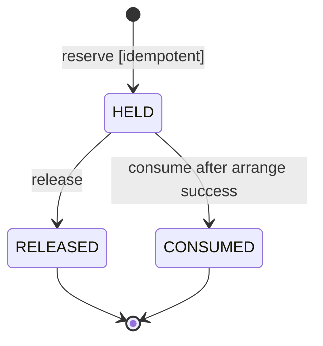
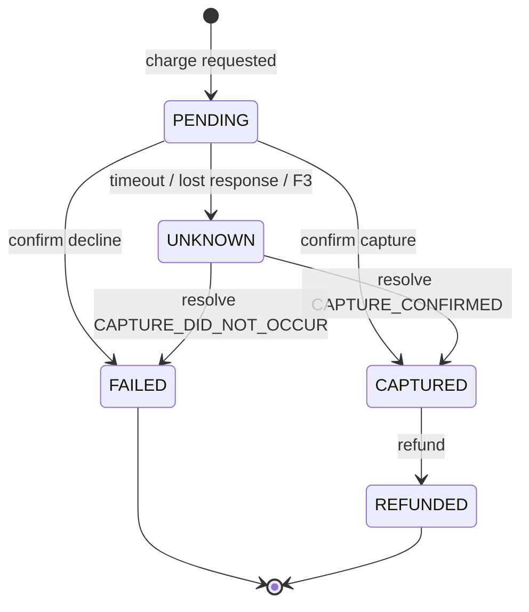
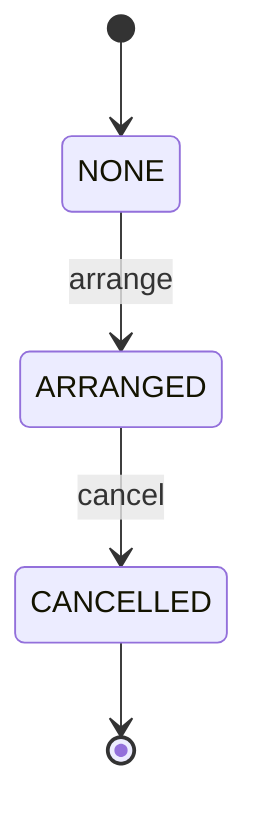

# Domain state models (TH-101 / TH-101.1)

Normative source: [`docs/protocol/BUSINESS_INVARIANTS_AND_ORACLE.md`](../protocol/BUSINESS_INVARIANTS_AND_ORACLE.md)  
Java: module `:contracts`  
OpenAPI layout: [`README.md`](README.md)

## Owner-confirmed contract decisions (TH-101.1)

| ID | Decision |
| --- | --- |
| **C-101-1** | Orchestration calls Inventory `consume` after Shipping `arrange` is confirmed successful |
| **C-101-2** | Money = `amountMinor` (integer) + `currency` |
| **C-101-3** | HTTP prefix `/api/v1` |

---

## Idempotency (TH-101.1)

| Rule | Behavior |
| --- | --- |
| Transport | HTTP header **`Idempotency-Key` only** (not in JSON body) |
| Same key + same logical payload | Return original operation result; **no** duplicate stock / capture / refund / shipment effects |
| Same key + different logical payload | **`409`** with `ErrorCode.IDEMPOTENCY_KEY_CONFLICT` |
| MVP scope | Single SKU per order; recommended header values in `IdempotencyKeys` |

Java: `IdempotencyRules`, `IdempotencyKeys`, `IdempotencyConflictException`.

---

## Reservation + consume



- **Terminal for MVP:** `RELEASED`, `CONSUMED` (no return to `HELD` for the same reservation).
- **`consume` (C-101-1):** orchestration only, after confirmed successful `arrange`.
- **`HELD → CONSUMED`:** single transition; `held` and `onHand` updated **atomically and exactly once**.
- Replay of the same consume key must **not** decrement stock again.

---

## Payment + resolve



| Probe outcome | Resulting state |
| --- | --- |
| `CAPTURE_CONFIRMED` | `CAPTURED` |
| `CAPTURE_DID_NOT_OCCUR` | `FAILED` |
| `INCONCLUSIVE` | keep `UNKNOWN` or `PENDING` |

- Timeout / missing information → **not** confirmed failure.
- Concurrent/repeated resolve: serialize per `paymentId`; same confirmed outcome is idempotent; contradictory confirmed outcomes → `INVALID_STATE_TRANSITION`.
- **No refund** unless `CAPTURED` (`PaymentTransitions.assertRefundAllowed` / `REFUND_NOT_ALLOWED`).

Java: `PaymentResolveRules`, `ResolveProbeOutcome`.

---

## Shipment



## Compensation order

1. Cancel shipment (if `ARRANGED`)  
2. Refund payment (if `CAPTURED`)  
3. Release inventory (if `HELD`)

## Happy path (A and C)

```text
reserve → charge(CAPTURED) → arrange → consume(HELD→CONSUMED)
```

## Stable error codes

`INSUFFICIENT_STOCK` · `INVALID_STATE_TRANSITION` · `IDEMPOTENCY_KEY_CONFLICT` · `NOT_FOUND` · `VALIDATION_ERROR` · `REFUND_NOT_ALLOWED`
