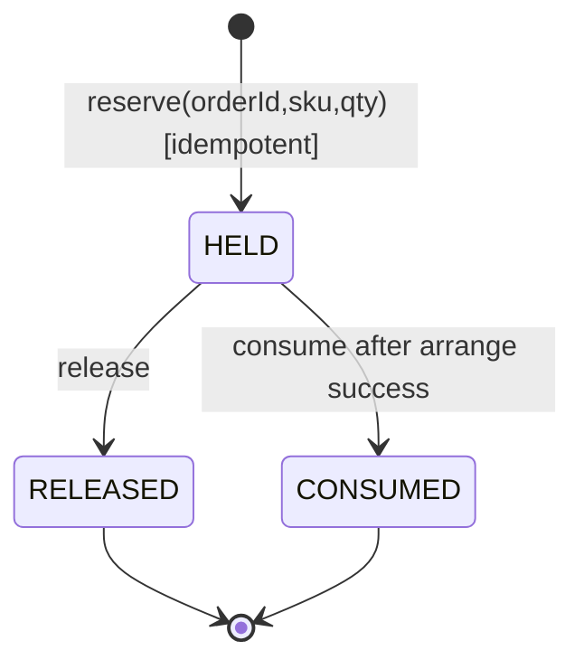
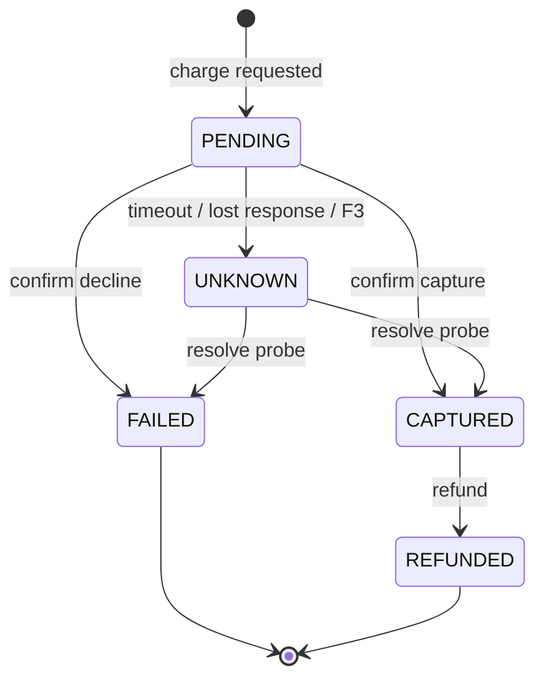
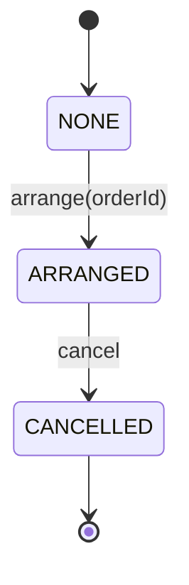

# Domain state models (TH-101)

Normative source: [`docs/protocol/BUSINESS_INVARIANTS_AND_ORACLE.md`](../protocol/BUSINESS_INVARIANTS_AND_ORACLE.md)  
Java DTOs / transition guards: module `:contracts`  
OpenAPI: [`openapi.yaml`](openapi.yaml)

## Reservation



- Success: **HELD → CONSUMED** (decrement `held` and `onHand` once — no double decrement).
- Compensation: **HELD → RELEASED** only (never release `CONSUMED`).

## Payment



- Timeout ≠ failure → typically **UNKNOWN**.
- **Do not refund** unless state is **CAPTURED** (contract guard in `PaymentTransitions.assertRefundAllowed`).
- UNKNOWN remains distinguishable from FAILED for the oracle (`AMBIGUOUS` if unresolved at TERMINAL).

## Shipment



## Compensation order

1. Cancel shipment (if `ARRANGED`)
2. Refund payment (if `CAPTURED`)
3. Release inventory (if `HELD`)

Encoded as `CompensationOrder` enum in `:contracts`.

## Orchestration aggregate (non-oracle)

`OrderProcessState` is an orchestration-view helper only. Oracle outcomes use `BusinessOutcome` + entity snapshots.

## Happy path (shared A and C)

```text
reserve → charge(CAPTURED) → arrange → consume(HELD→CONSUMED)
```

## Design assumptions recorded for Owner (not new research approvals)

| ID | Topic | Choice in TH-101 | Needs Owner? |
| --- | --- | --- | --- |
| C-101-1 | Who calls `consume`? | Orchestration calls inventory `consume` after successful `arrange` (services decoupled) | Confirm if preferred otherwise |
| C-101-2 | Money representation | `amountMinor` + ISO currency (`Money`) | Confirm PLN minor units OK for MVP |
| C-101-3 | HTTP prefix | `/api/v1/...` | Cosmetic — OK to change in TH-102..104 if needed |
