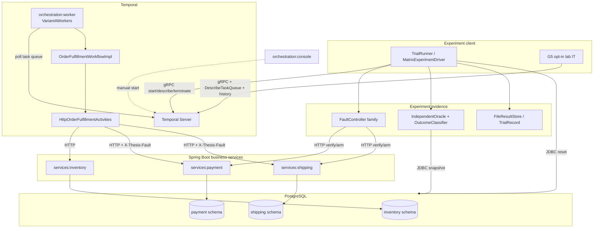
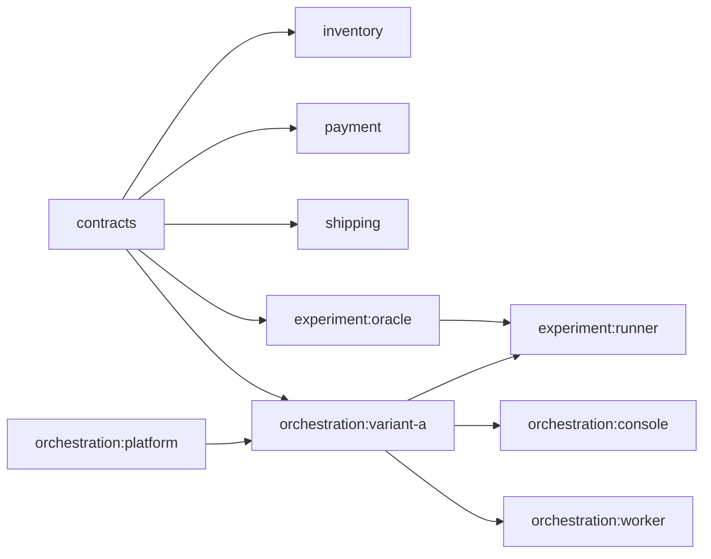

# 02 — System architecture

## Component diagram (as-built Variant A + harness)

### Communication kinds

| Path | Mechanism |
| --- | --- |
| Runner → Temporal | Temporal Java SDK (workflow stub) |
| Worker ↔ Temporal | Task-queue polling |
| Activities → services | HTTP REST |
| Services → DB | JDBC / Spring Data |
| Oracle → DB | JDBC read-only snapshot |
| Fault verify | HTTP probes with fault headers |
| Evidence | Filesystem JSON/CSV via `FileResultStore` |

## Module relationships (Gradle)

## What is not in the diagram

- **Variant C** workflow / LLM activity — not present as a module  
- Toxiproxy / network chaos — not the F1–F3 mechanism (header injection is)  
- Live EXP-* result DB — only file ResultStore for harness artifacts  
