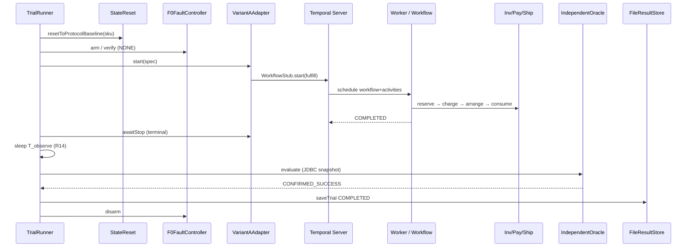
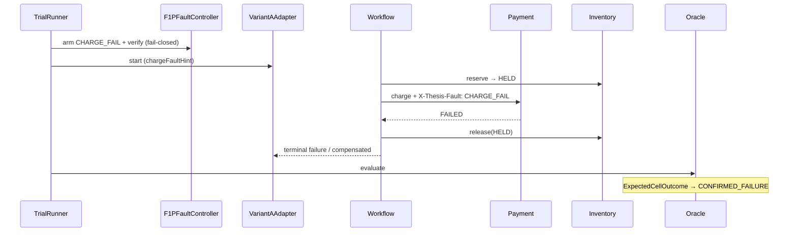
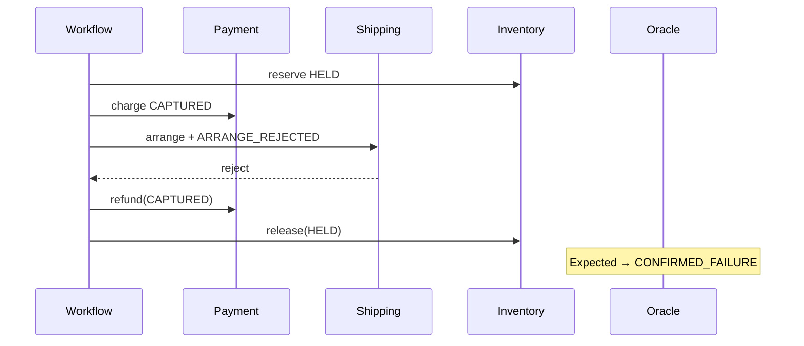
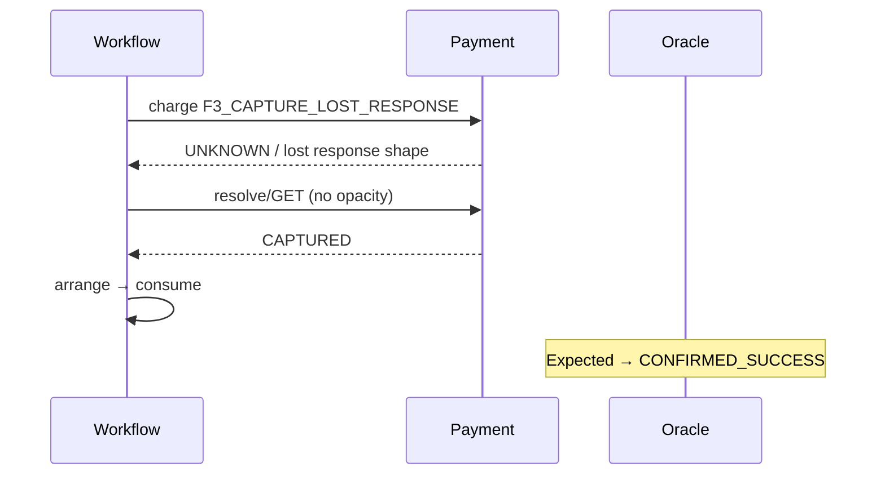
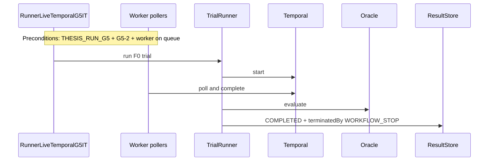

# 04 — Runtime lifecycle (sequence diagrams)

Timings from `RunnerTiming`: `PROTOCOL_T_RUN_MAX = 120s`, `PROTOCOL_T_OBSERVE = 30s`, `DEFAULT_QUIESCE_WAIT = 5s` (engineering default, not a separate protocol letter like R6/R14).

## 1. F0 happy path



**Starts:** harness `TrialRunner.run` with profile F0.  
**Retried:** transient activity HTTP (ActivityPolicies).  
**Compensated:** nothing on success.  
**Persisted:** `TrialRecord` + Oracle summary.  
**Tests:** `TrialRunnerLifecycleTest`, `OrderFulfillmentHappyPathIT` (CompIT, not full harness).

## 2. F1-P (payment charge fail)



**Compensated:** release reservation (no CAPTURED ⇒ no refund).  
**Tests:** `TrialRunnerF1PLifecycleTest`, `F1PFaultControllerTest`, CompensationIT charge-fail paths.

## 3. F2 (arrange rejected after capture)



**Tests:** `TrialRunnerF2LifecycleTest`, `F2FaultControllerTest`, CompensationIT.

## 4. F3-Recovered



**Tests:** `TrialRunnerF3LifecycleTest`, `F3FaultControllerTest`, payment F3 integration.

## 5. F3-Unresolved

```mermaid
sequenceDiagram
  participant W as Workflow
  participant Pay as Payment
  participant OR as Oracle
  participant Gate as F3UnresolvedAcceptanceGate

  W->>Pay: charge F3_CAPTURE_LOST_RESPONSE
  W->>Pay: resolve/GET + RESOLVE_TRANSPORT_OPAQUE
  Pay-->>W: still UNKNOWN/PENDING
  W-->>W: no arrange; ambiguous business failure path
  OR-->>OR: AMBIGUOUS (UNKNOWN/PENDING payment)
  Gate->>Gate: requireF3UnresolvedGate
```

**Tests:** F3 lifecycle unresolved cases, `F3UnresolvedAcceptanceGateTest`.

## 6. TrialRunner lifecycle (generic)

```mermaid
sequenceDiagram
  participant TR as TrialRunner
  participant Env as ENV/JDBC gates
  participant SR as StateReset
  participant FC as FaultController
  participant VA as VariantAdapter
  participant OR as Oracle
  participant RS as ResultStore

  TR->>Env: assertSafeForDestructiveOps
  TR->>SR: reset
  TR->>FC: arm
  TR->>FC: verify
  alt verify failed
    TR->>RS: EXCLUDED FAULT_VERIFY_FAILED
  else ok
    TR->>VA: start
    TR->>VA: awaitStop until T_run_max
    alt not terminal
      TR->>VA: describe; maybe terminate(T_run_max) R6
    end
    TR->>VA: awaitStop quiesce
    alt not quiesced
      TR->>RS: EXCLUDED WORKFLOW_NOT_QUIESCED (block further)
    else
      TR->>TR: sleep T_observe
      TR->>OR: evaluate once
      TR->>TR: F3UnresolvedAcceptanceGate.rejectReason (F3-Unresolved only)
      alt gate rejects
        TR->>RS: EXCLUDED F3_UNRESOLVED_ACCEPTANCE_FAILED
      else
        TR->>RS: COMPLETED TrialRecord (OWN-P1 persist path)
      end
    end
  end
  TR->>FC: disarm (finally)
```

**Implementation note:** Natural completion race: before R6 terminate, `describe` may observe terminal → `TerminatedBy.WORKFLOW_STOP` (not `T_RUN_MAX`).  
**F3-Unresolved:** after Oracle, `F3UnresolvedAcceptanceGate.rejectReason` can still EXCLUDE a trial even when classification is `AMBIGUOUS` if the harness gate predicate fails (`TrialRunner.run`).

## 7. G5-2 (worker UP, natural completion)



**Status:** code **CI-verified**; scenario **not live-tested** without Owner auth.

## 8. G5-3 (no pollers, R6 terminate, history gate)

```mermaid
sequenceDiagram
  participant IT as RunnerLiveTemporalG5IT
  participant Pre as G5IsolationPreflight
  participant Probe as DescribeTaskQueueProbe
  participant TR as TrialRunner
  participant TS as Temporal
  participant Hist as G5HistoryFetcher/Gate
  participant Acc as G5AcceptanceEvaluator/Writer

  IT->>Pre: require no pollers
  Pre->>Probe: anyPollerDetected(queue)
  alt pollers or API error
    Pre-->>IT: fail-closed (not VALID)
  else exclusive
    IT->>TR: run (will hit T_run_max)
    TR->>TS: start (no worker progress)
    TR->>TS: terminate T_run_max after 120s
    TR->>TR: quiesce + T_observe + Oracle once
    TR->>TR: persist TrialRecord (harness COMPLETED possible)
    IT->>Hist: fetch all pages; validate eventId order
    IT->>Acc: evaluate; write g5-3-acceptance.json only if VALID
  end
```

**Critical:** `harnessStatus=COMPLETED` ≠ G5-3 acceptance `VALID`. Acceptance also needs history gate, exclusivity, TERMINATED evidence, etc. EXCLUDED TrialRecord never yields VALID G5-3.

**Tests (non-live):** `G5HistoryGateTest`, `G5AcceptanceEvaluator` tests, `G5IsolationPreflightTest`, `G5OptInCiSafetyTest`. Live: `RunnerLiveTemporalG5IT` (opt-in only).
