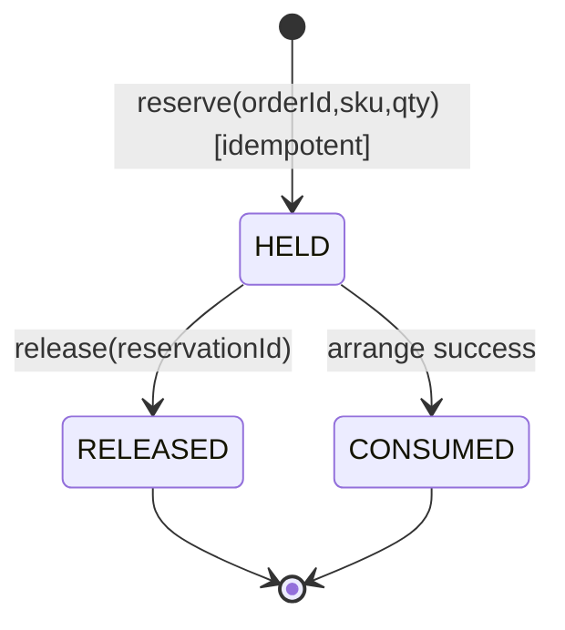
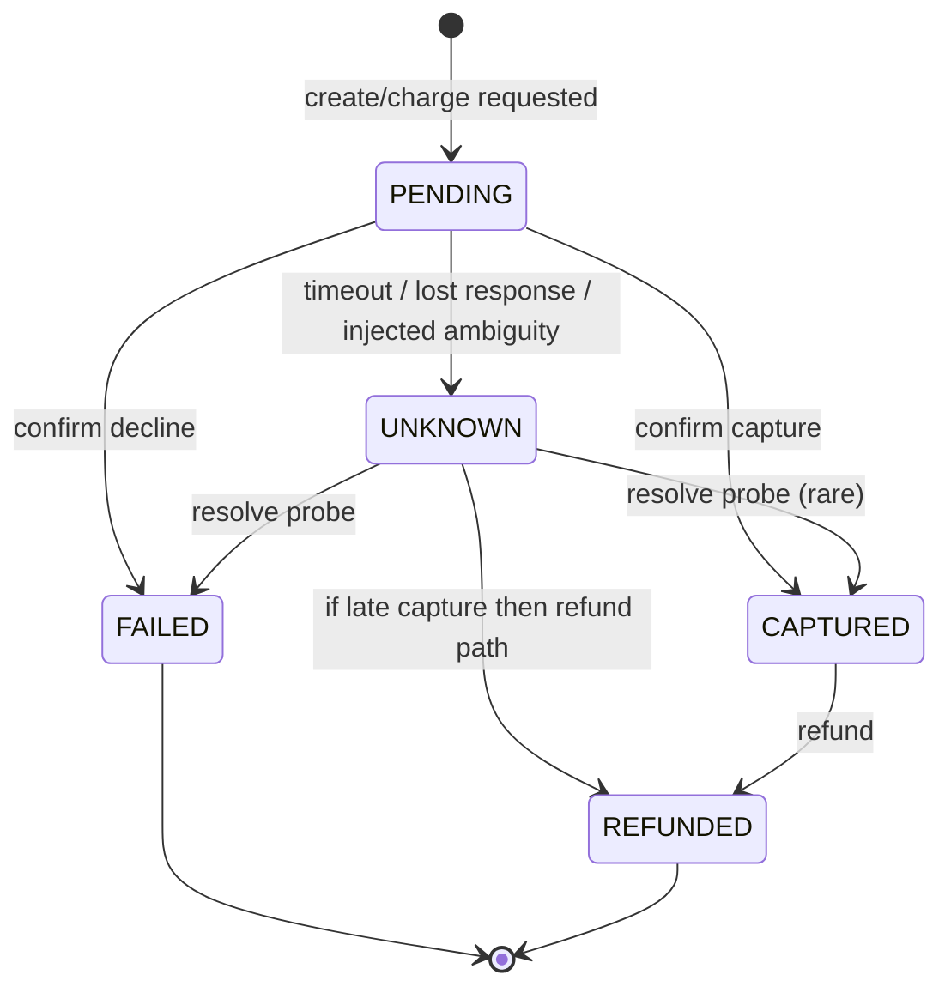
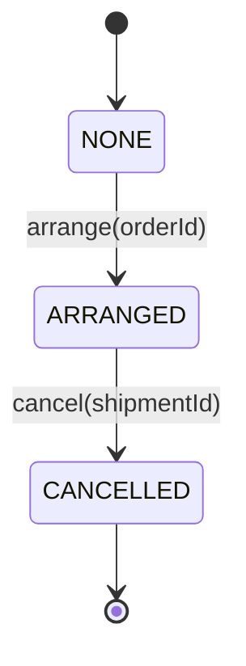
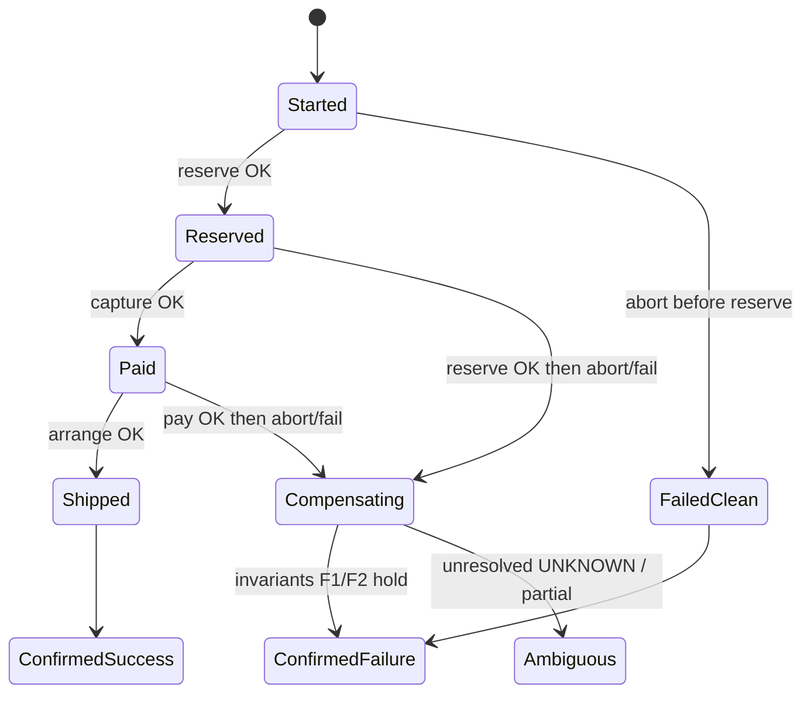

# Business invariants and independent end-state oracle (TH-011)

| | |
| --- | --- |
| **Status** | Design decision — frozen for MVP drafting (Owner executed TH-011) |
| **Applies to** | Variant **A** and Variant **C** identically |
| **Ticket** | TH-011 |
| **Does not cover** | Variant B, RQ4, latency/cost metrics, Temporal-internal workflow status as business success |
| **Label key** | **Design decision** = chosen for MVP · **Open question** = needs Owner/later confirm · **Assumption** = provisional |

> Business correctness is evaluated only against this document. LLM text, agent “OK”, and orchestration *Completed* status are **never** sufficient for RQ1 success.

---

## 1. Business process (minimal)

One order fulfillment saga over three local services:

1. **Reserve** inventory for SKU `qty`.
2. **Charge** payment for the order.
3. **Arrange** shipment.

Happy path: `Reserve → Charge → Arrange`.  
On failure after reserve (or after charge, before arrange): compensate in reverse order of completed forward steps.

### 1.1 Entities

| Entity | Identity | Relevant fields (MVP) |
| --- | --- | --- |
| **Order** | `orderId` (UUID) | `status` (order-level aggregate — see §2) |
| **Reservation** | `reservationId` + `orderId` | `sku`, `qty`, `state` ∈ {`HELD`, `RELEASED`, `CONSUMED`} |
| **Payment** | `paymentId` + `orderId` | `amount`, `state` ∈ {`PENDING`, `CAPTURED`, `FAILED`, `UNKNOWN`, `REFUNDED`} |
| **Shipment** | `shipmentId` + `orderId` | `state` ∈ {`NONE`, `ARRANGED`, `CANCELLED`} |
| **SKU stock** | `sku` | `onHand`, `held` (non-negative integers) |

Stock identity: `available = onHand - held` must stay ≥ 0 (invariant I1).  
`held` counts only reservations in `HELD`. On success, `arrange` moves reservation **`HELD` → `CONSUMED`** and decrements both `held` and `onHand` by `qty` (**OQ-1 resolved in protocol-v0 / D-012**).

---

## 2. Order-level outcomes (oracle labels)

The oracle assigns exactly one **business outcome** per run after the orchestration has stopped attempting progress (timeout of the *run harness*, not of a single HTTP call — see §6).

| Outcome code | Meaning | RQ1 “business success”? |
| --- | --- | --- |
| `CONFIRMED_SUCCESS` | Order fully fulfilled under invariants | **Yes** |
| `CONFIRMED_FAILURE` | Process ended with consistent failed/compensated business state | **No** (but may be **correct** recovery — RQ2) |
| `AMBIGUOUS` | Observable state does not allow confirmed success or confirmed failure | **No** |
| `INVALID` | Invariant violated (illegal combination) | **No** (correctness failure) |

**Design decision:** RQ1 primary rate uses only `CONFIRMED_SUCCESS`.  
**Design decision:** RQ2 evaluates runs that injected faults: whether the terminal label is `CONFIRMED_FAILURE` with valid compensation, vs `AMBIGUOUS` / `INVALID`.

### 2.1 Confirmed success — required snapshot

All must hold:

- Reservation: **`CONSUMED`** (after successful arrange; was `HELD` during pay)
- Payment: `CAPTURED`
- Shipment: `ARRANGED`
- Stock: `held` no longer includes this order’s qty; `onHand` reduced by `qty`
- No conflicting leftovers (no second active `HELD` reservation for same `orderId`)

### 2.2 Confirmed failure — acceptable terminal snapshots

Exactly one of the following consistent patterns (others → `INVALID` or `AMBIGUOUS`):

| Pattern | Reservation | Payment | Shipment |
| --- | --- | --- | --- |
| **F0** never started / aborted before reserve | no row or not `HELD` | not `CAPTURED` | `NONE` |
| **F1** failed after reserve, compensated | `RELEASED` | not `CAPTURED` (or never created / `FAILED` / `REFUNDED` if charged then refunded) | `NONE` or `CANCELLED` |
| **F2** failed after charge, compensated | `RELEASED` | `REFUNDED` (if had `CAPTURED`) or `FAILED` (if charge failed) | `NONE` or `CANCELLED` |

**Design decision:** `CONFIRMED_FAILURE` requires **no** `HELD` reservation and **no** `ARRANGED` shipment left dangling without matching payment rules above.

### 2.3 Unknown / ambiguous

| Situation | Oracle label |
| --- | --- |
| Payment.state = `UNKNOWN` and orchestration has stopped | `AMBIGUOUS` (unless a later probe resolves to `CAPTURED`/`FAILED`/`REFUNDED` before oracle read — then reclassify) |
| Timeout of a **call** without knowing server effect | Must **not** be treated as failure; leave or set payment/`PENDING`→ escalate to `UNKNOWN` if unrecovered |
| Partial state not matching F0–F2 or success | `AMBIGUOUS` or `INVALID` per invariants |

**Design decision:** A **timeout does not mean the operation failed.** It means the client lacks a confirmed outcome. The payment simulator must support an explicit `UNKNOWN` (or stuck `PENDING` that the oracle maps to ambiguous if still unresolved at harness end).

---

## 3. State machines (per entity)

### 3.1 Reservation



Forbidden: `RELEASED`/`CONSUMED` → `HELD` for same `reservationId`. New reserve = new id.

### 3.2 Payment



**Design decision:** From `UNKNOWN`, the business process must not proceed to `Arrange` until resolved or the saga chooses compensate/abort treating unresolved payment as non-success (→ typically `AMBIGUOUS` if left `UNKNOWN` at end).

### 3.3 Shipment



### 3.4 Aggregate order process (orchestration view)



Orchestration-internal names are **not** oracle inputs; only entity snapshots are (§7).

---

## 4. Invariants (pass/fail)

Each invariant is checked on the **oracle snapshot** for one `orderId` (plus SKU stock).

| ID | Statement | Pass | Fail |
| --- | --- | --- | --- |
| **I1** | Stock accounting | `onHand ≥ held ≥ 0` and `held` equals sum of qty over reservations in `HELD` for SKU | Any negative or mismatch |
| **I2** | Single active hold per order | At most one `HELD` reservation for `orderId` | Two+ `HELD` |
| **I3** | No ship without capture | If shipment `ARRANGED`, then payment `CAPTURED` (if later refunded, shipment must be `CANCELLED`, not stay `ARRANGED`) | `ARRANGED` with payment not `CAPTURED` |
| **I4** | Capture paired with reservation | Terminal: `CAPTURED` ⇒ reservation `HELD` or `CONSUMED`, **or** (`REFUNDED` + `RELEASED`) per F2 | Terminal `CAPTURED` + `RELEASED` without `REFUNDED`; or `CAPTURED` with no reservation |
| **I5** | Success package | `CONFIRMED_SUCCESS` ⇒ payment `CAPTURED` ∧ reservation `CONSUMED` ∧ shipment `ARRANGED` ∧ I1–I3 | Any missing |
| **I6** | Failure cleanliness | `CONFIRMED_FAILURE` ⇒ reservation not `HELD` ∧ shipment not `ARRANGED` ∧ payment not left as bare `CAPTURED` without refund | Dangling hold/ship/capture |
| **I7** | Idempotent effects | Replaying the same idempotency key does not double-hold, double-charge, double-ship, or double-consume | Duplicate side effects |

**I4 note:** Oracle runs **only at harness TERMINAL** (see protocol-v0), not mid-flight.

---

## 5. Idempotency requirements

| Operation | Idempotency key | Required behavior |
| --- | --- | --- |
| `reserve` | `orderId` (or `Idempotency-Key` header = `orderId:reserve`) | Second call returns same `reservationId` / `HELD`; does not increase `held` again |
| `release` | `reservationId` | Second call no-ops if already `RELEASED` |
| `charge` | `orderId` (or `orderId:charge`) | Second call returns same `paymentId` and same terminal-ish state; no double `CAPTURED` amount |
| `refund` | `paymentId` | Second call no-ops if `REFUNDED` |
| `arrange` | `orderId` | Second call returns same `shipmentId`; no second `ARRANGED`; consume at most once |
| `cancel` shipment | `shipmentId` | Second call no-ops if `CANCELLED` |

**Design decision:** Keys are mandatory on all mutating APIs used by A and C (same tool/API surface).

---

## 6. Compensation semantics

**Design decision — order of compensation** (reverse of completion):

1. If shipment `ARRANGED` → `cancel` → `CANCELLED`
2. If payment `CAPTURED` → `refund` → `REFUNDED`; if `PENDING`/`UNKNOWN` → **do not refund**; attempt resolve or leave → may yield `AMBIGUOUS`
3. If reservation `HELD` → `release` → `RELEASED` (never “release” a `CONSUMED` row; success path already consumed)

**Observable remains:** Rows may remain with terminal states (`RELEASED`, `REFUNDED`, `CANCELLED`); that is success of compensation, not “delete everything”.

**Design decision:** Compensation is **business-level** (service APIs), not “delete Temporal history”.

---

## 7. Independent oracle

### 7.1 Independence

| Allowed inputs | Forbidden inputs |
| --- | --- |
| Service DB rows and/or read-only query APIs for inventory/payment/shipping | LLM messages / “I succeeded” |
| Harness metadata: `orderId`, variant id, code commit, clock | Temporal workflow status alone as success |
| Explicit payment resolve endpoints’ **data** | Agent tool-call logs as proof of business effect |

Tool logs may be used for **RQ3** metrics only, never to flip RQ1 pass/fail.

### 7.2 Inputs → outputs

**Input**

```text
orderId, sku
snapshot sources: reservation, payment, shipment, stock
harness_phase: TERMINAL
```

**Output**

```text
outcome ∈ {CONFIRMED_SUCCESS, CONFIRMED_FAILURE, AMBIGUOUS, INVALID}
violated_invariants: [I#...]
pattern ∈ {SUCCESS, F0, F1, F2, NONE}   # explanatory
evidence: {reservation, payment, shipment, stock}  # copied fields
```

### 7.3 API observation vs direct DB inspection

| Approach | Pros | Cons |
| --- | --- | --- |
| **HTTP read APIs** only | Matches production-like boundary; same path A/C tools use | Bugs in read API hide true state; need trust in API correctness |
| **Direct DB** only | Strong ground truth for local Postgres/H2 | Couples tests to schema; bypasses API bugs you might want to catch |
| **Hybrid** | DB as ground truth; API cross-check optional | Slightly more harness code |

**Recommendation (Design decision for local MVP):**

1. **Primary oracle = direct database read** of the three service stores (local experimental environment, single machine).  
2. **Secondary (optional) check:** GET APIs must agree with DB on the same fields; disagreement → harness error (`ORACLE_DISAGREEMENT`), not silent RQ1 pass.

Rationale: RQ1 claims are about **actual business state**; local DB is the simplest reliable source. API agreement is a useful sanity check but not the definition of truth for the thesis.

### 7.4 Separation from other metrics

| Concern | Where |
| --- | --- |
| Business correctness | This oracle → RQ1 / part of RQ2 |
| Technical completion (workflow Completed) | Separate field in result schema |
| Recovery duration / latency / LLM cost | RQ2 timing / RQ3 — **not** oracle outcome |
| Invalid tool calls | RQ3 — logged independently |

---

## 8. Shared evaluation for A and C

- Same entities, transitions, invariants I1–I7, outcome codes.
- Same idempotency keys and compensation order.
- Same oracle implementation (TH-401) invoked identically after A or C runs.
- Variant C’s LLM may only **select among allowed actions**; it cannot redefine success.

---

## 9. Open questions status

| ID | Topic | Status |
| --- | --- | --- |
| OQ-1 | Consume on ship | **Resolved (protocol-v0 / D-012):** `HELD` → `CONSUMED` on successful arrange |
| OQ-2 | UNKNOWN payment in MVP faults | **Resolved:** fault **F3** mandatory; timeout ≠ failure; no refund without confirmed capture |
| OQ-3 | TERMINAL timing | **Resolved:** `T_observe=30s`, `T_run_max=120s`; unresolved UNKNOWN → `AMBIGUOUS` |
| OQ-4 | Multi-SKU | Out of MVP |
| OQ-5 | Partial qty ship | Out of MVP |
| OQ-6 | Spec in repo | Done |

Remaining Owner inputs (n, model): see `EXPERIMENTAL_PROTOCOL_V0.md` §12.

---

## 10. Acceptance checklist (TH-011)

- [x] Same rules for A and C  
- [x] Oracle independent of orchestration/LLM decision logic  
- [x] Unknown payment handled explicitly; timeout ≠ failure  
- [x] Every invariant has pass/fail  
- [x] Minimal process (3 services, one SKU order)  
- [x] Open questions listed  

---

## Related

- Vault: `Metrics and Operational Definitions`, `Experimental Protocol`, `Scope and Non-Goals`
- Implementation later: `experiment/oracle/` (TH-401), APIs (TH-101–104)
- Coordination: TH-011 complete → next TH-012 (protocol draft)
