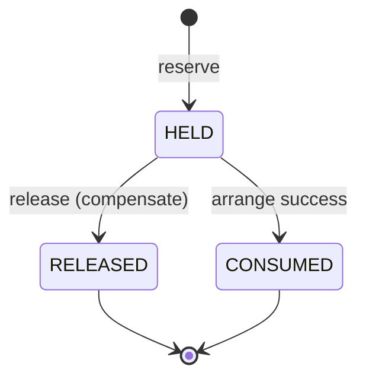
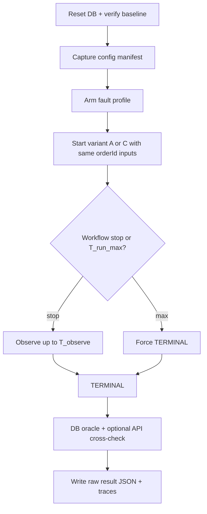

# Experimental Protocol v0 — A vs C MVP

| Field | Value |
| --- | --- |
| **Protocol ID** | `protocol-v0` |
| **Status** | Draft design decision (TH-012) — **not** confirmatory evidence |
| **Date** | 2026-10-24 |
| **Variants** | **A** deterministic Temporal + compensation · **C** Temporal + bounded LLM decisions |
| **Normative business rules** | [`BUSINESS_INVARIANTS_AND_ORACLE.md`](BUSINESS_INVARIANTS_AND_ORACLE.md) (as amended by §2 of this document) |
| **Change policy** | Any material change bumps version (`protocol-v0.1` / `v1`) and is logged in Decision Log. Confirmatory runs use a **frozen** id (TH-501). |

**Labels:** Design decision · Hypothesis · Open (Owner) · Assumption — never treat protocol text as experimental findings.

---

## 1. Research questions and metrics

Aligned with vault Research Questions / D-008 (Owner-approved priorities).

| RQ | Role | Primary metric(s) | Notes |
| --- | --- | --- | --- |
| **RQ1** | CORE | `RQ1_completion` = share of eligible runs with oracle `CONFIRMED_SUCCESS`; `RQ1_invalid` = share with `INVALID` | Self-reported LLM success **excluded** |
| **RQ2** | CORE | On fault-injected runs: `RQ2_safe_recovery` = share with `CONFIRMED_FAILURE` matching F0–F2; `RQ2_ambiguous` = share `AMBIGUOUS`; `RQ2_recovery_duration` = fault visibility → harness TERMINAL | Ambiguous at deadline ≠ success and ≠ invariant violation |
| **RQ3** | Secondary | E2E latency; (C) inference latency; (C) invalid tool-call rate | Reported separately from RQ1/RQ2 |

**Hypothesis (not finding):** Under transient faults, A ≳ C on end-state correctness; C may add latency/cost and tool-error modes.

### 1.1 Outcome classes (run-level)

| Class | Definition |
| --- | --- |
| **Successful completion** | Oracle `CONFIRMED_SUCCESS` |
| **Safe unresolved / compensated termination** | Oracle `CONFIRMED_FAILURE` (clean F0–F2) |
| **Ambiguous termination** | Oracle `AMBIGUOUS` (e.g. payment still `UNKNOWN` at deadline) |
| **Business invariant violation** | Oracle `INVALID` |
| **Technical / harness failure** | Runner crash, oracle disagreement, DB down, misconfigured fault — **excluded** from RQ rates but **recorded** |

---

## 2. Resolutions of TH-011 open questions

### 2.1 OQ-1 — Inventory on successful shipment

| | |
| --- | --- |
| **Decision** | On successful `arrange`, reservation **`HELD` → `CONSUMED`**: decrement `held` by `qty` and decrement `onHand` by `qty`. |
| **Rationale** | Matches fulfillment semantics; leaves stock consistent across repeated runs; avoids permanent holds after success. |
| **Alternatives considered** | (a) Leave `HELD` forever — simpler code, weaker stock story, pollutes multi-run availability. (b) Separate async “consume” step — extra state, not needed for MVP. |
| **Invariant impact** | Amend I1: `held` = sum of `HELD` only; `CONSUMED`/`RELEASED` do not contribute to `held`. Amend I5: success ⇒ reservation `CONSUMED` ∧ payment `CAPTURED` ∧ shipment `ARRANGED`. Amend I4 terminal success: `CAPTURED` with `CONSUMED` allowed. |

Reservation states: `{HELD, RELEASED, CONSUMED}`.



### 2.2 OQ-2 — Ambiguous payment (mandatory in MVP fault set)

| | |
| --- | --- |
| **Decision** | Include fault **F-PAY-AMB**: client observes **timeout / lost response** on `charge`, while the payment service **may have captured** (hidden success). Orchestration must treat client-side timeout as **non-confirmed**, typically payment row `UNKNOWN` (or unresolved `PENDING` mapped to ambiguous at TERMINAL). |
| **Rules** | (1) Timeout alone ≠ `CONFIRMED_FAILURE`. (2) **Do not `refund` unless capture is confirmed** (`CAPTURED`). (3) Probe/resolve may later flip `UNKNOWN`→`CAPTURED`/`FAILED` before TERMINAL. |
| **Rationale** | Core to RQ1/RQ2 fairness; literature and thesis goal emphasize ambiguous outcomes. |
| **Alternatives** | Defer UNKNOWN to OPTIONAL — rejected for MVP (would weaken RQ2). |

### 2.3 OQ-3 — When a run is TERMINAL

| Phase | Rule |
| --- | --- |
| **Workflow stop** | Variant reports finished / failed / cancelled **or** harness hits `T_workflow_max` |
| **Observation window** | After workflow stop, wait up to **`T_observe = 30s`** for payment resolve probes / async compensation to settle |
| **Hard deadline** | `T_run_max = 120s` from run start (wall clock). At deadline → force TERMINAL, run oracle once |
| **UNKNOWN at TERMINAL** | If payment still `UNKNOWN` (or unresolved) → oracle **`AMBIGUOUS`**. Count under RQ2 as **recovery-not-confirmed** (`RQ2_ambiguous`), **not** as `INVALID` unless other invariants break |

| | |
| --- | --- |
| **Rationale** | Fixed bounds keep A/C comparable; 30s observe allows local resolve without indefinite hangs; 120s caps runaway LLM/retry loops. |
| **Alternatives** | Longer observe (60–120s) — may inflate C latency unfairly; shorter (5s) — may over-label AMBIGUOUS. |

**Assumption:** Local Docker Postgres + Temporal on one machine; adjust only with protocol bump if needed.

---

## 3. Shared initial conditions (A and C)

| Item | Value |
| --- | --- |
| DB | **PostgreSQL** (local), **schema-per-service** (`inventory` / `payment` / `shipping` in DB `business`) — **Design decision** (TH-100 / D-013); host port **5433** |
| SKU | `SKU-MVP-1` |
| Stock | `onHand = 100`, `held = 0`, no leftover reservations |
| Order | Fresh `orderId` UUID per run; `qty = 1`; fixed `amount` |
| Network | Localhost; no shared in-flight work across variants |
| Contracts | Identical APIs, idempotency keys, compensation ops (TH-011) |
| Clocks | Harness records `t0`, fault time, TERMINAL time |

Reset procedure (each run): truncate/reset service tables for test tenant **or** use unique SKU+order namespace; verify I1 baseline before start.

---

## 4. Minimal fault scenarios

Both variants receive the **same** fault profile per paired run. Trigger points are service-side (or proxy), not variant-specific.

| ID | Name | Trigger point | Injected behavior | Expected stress |
| --- | --- | --- | --- | --- |
| **F0** | Happy path | — | None | RQ1 baseline |
| **F1** | Inventory fail after intent | On `reserve` **or** immediately after successful reserve before pay | Fail next forward step / force compensate | RQ2 compensation after hold |
| **F2** | Ship fail after pay | After `CAPTURED`, on `arrange` | Arrange fails → compensate (refund + release/cancel) | RQ2 F2 pattern |
| **F3** | Ambiguous payment | On `charge` | Client timeout; service **may** capture; client sees UNKNOWN | RQ1/RQ2 ambiguity |

**Out of MVP protocol-v0:** multi-SKU, dual Toxiproxy+chaos, LLM fine-tune, Variant B.

Fault mechanism (**Assumption** until TH-400): test doubles **or** Toxiproxy — pick one in TH-400; both variants use the same choice.

---

## 5. Run procedure



1. Reset and baseline check.  
2. Write manifest (git SHA, protocol id, variant, fault id, model id for C, seeds if any).  
3. Arm fault.  
4. Start orchestration (A or C) with identical business inputs.  
5. Wait per §2.3 → TERMINAL.  
6. Run **independent DB oracle** (TH-011/D-011).  
7. Persist raw artifact; never delete failed/ambiguous runs.

---

## 6. Oracle and operation trace

| Artifact | Role |
| --- | --- |
| **DB oracle** | Sole authority for RQ1/RQ2 business labels |
| **API cross-check** | Optional; mismatch → `TECHNICAL_FAILURE` / `ORACLE_DISAGREEMENT` |
| **Operation trace** | Ordered tool/API calls, HTTP status, idempotency keys, Temporal activity ids — for RQ3 and debugging; **not** success proof |
| **LLM transcript (C)** | Stored; never flips oracle |

---

## 7. Repetitions, pilot vs confirmatory

| Phase | Purpose | Analysis |
| --- | --- | --- |
| **Pilot** | Debug harness, faults, oracle, logging | Issues logged; results **not** mixed into confirmatory tables |
| **Confirmatory** | After protocol freeze (TH-501) | Immutable raw store; failed/ambiguous kept |

**Repetitions (Assumption for planning):** Pilot ≥ 3 runs per (variant × fault). Confirmatory *n* chosen at freeze (Open — Owner); protocol-v0 does not claim statistical power.

Pairing: for each fault id, run A and C under the same injection config and seed material where applicable.

---

## 8. Reporting rules

| Event | How reported |
| --- | --- |
| Success / failure / ambiguous / invalid | Oracle fields in raw JSON |
| Timeout (call) | Trace event; payment→UNKNOWN path; not auto-failure |
| Timeout (run) | `terminated_by: T_run_max` |
| Latency | `t_terminal - t0`; (C) sum/mean inference spans |
| Invalid tool calls (C) | Count + examples in trace; RQ3 only |
| Exclusions | `exclusion_reason` enum; row retained in `excluded/` or flagged — **never silent drop** |

### 8.1 Exclusion criteria (record, do not hide)

- Harness/oracle infra failure  
- Manifest incomplete (missing git SHA / protocol id)  
- Wrong fault armed / cross-talk between runs  
- Manual abort  

Excluded runs are listed in the archive index with reason.

---

## 9. Fairness constraints

- Same faults, contracts, initial stock, oracle, deadlines for A and C.  
- No confirmatory-driven prompt/scenario tuning (pilot fixes only, then freeze).  
- C capabilities ⊆ same business API surface as A.  
- Hypotheses remain hypotheses until confirmatory analysis (TH-601).

---

## 10. Raw result storage (planned layout)

```text
experiment/results/
  raw/
    protocol-v0/
      pilot/
      confirmatory/    # only after TH-501 freeze
  excluded/
  manifests/
```

Each run file: `run_id`, `protocol_id`, `variant`, `fault_id`, `git_sha`, `oracle_outcome`, `timings`, `trace_ref`, `model` (C), `exclusion` nullable.

---

## 11. Threats to validity and limits

| Threat | Mitigation / limit |
| --- | --- |
| Single-machine lab ≠ production | Claim only local microservices comparison |
| Fault injectors unrealistic | Document mechanism; limited F0–F3 set |
| LLM non-determinism | Report variance; optional seed; pass^k only if collected |
| Oracle/schema bugs | API cross-check; pilot debugging |
| Small *n* | No overclaim; exploratory vs confirmatory labeled |
| Researcher bias | Freeze protocol before confirmatory; no silent exclusions |

**Generalization:** Results do not generalize to arbitrary agents, clouds, or payment providers.

---

## 12. Decisions still requiring Owner input

| ID | Question | Protocol-v0 default if deferred |
| --- | --- | --- |
| **OWN-1** | Confirmatory *n* per cell (variant × fault) | Defer to TH-501; pilot uses ≥3 |
| **OWN-2** | Exact LLM model + temperature for C | Defer to TH-300; record whatever is chosen in manifest |
| **OWN-3** | Confirm OQ-1 `CONSUMED` (vs revert to leave `HELD`) | **Adopted in §2.1** pending Owner veto |
| **OWN-4** | Confirm `T_observe=30s` / `T_run_max=120s` | **Adopted in §2.3** pending Owner veto |

---

## 13. Acceptance checklist (TH-012)

- [x] Protocol id + change policy  
- [x] OQ-1..3 resolved with rationale/alternatives  
- [x] RQ metrics separated; ambiguous ≠ success ≠ INVALID  
- [x] Minimal faults F0–F3; F3 = ambiguous payment  
- [x] Initial conditions, procedure, oracle, traces  
- [x] Pilot ≠ confirmatory; exclusions recorded  
- [x] Threats/limits; PostgreSQL planned  
- [x] No application implementation / no experiments run  

---

## Related

- TH-011 oracle spec · D-011 · D-012 (this protocol)  
- Next engineering: TH-100 / TH-101 (after Owner priority) · TH-400 fault wiring  
